```{r setup, include=FALSE}
knitr::opts_chunk$set(
  echo = FALSE, fig.align = "center",
  fig.width = 10, fig.height = 4.2, dpi = 150,
  message = FALSE, warning = FALSE
)
library(ggplot2)
theme_set(theme_minimal(base_size = 15))

# Every number in this deck is read from the files comparison/run.R writes
# (comparison/export/r/*.csv, through read_exports() in comparison/R/site.R) or recomputed
# from the two analyses' export contracts (read_contracts(), bridge_inputs()). Nothing is
# retyped except the authors' printed values, which come from the same files.
for (f in list.files("../../comparison/R", pattern = "[.]R$", full.names = TRUE)) source(f)
root <- comparison_root()
ex <- read_exports(file.path(root, "comparison", "export", "r"))
k  <- read_contracts(root)
bi <- bridge_inputs(k); sup <- bi$sup; rj <- bi$rauh
vs <- score_common(sup); vr <- score_common(rj)          # the two ends, every term
ep <- ex$endpoints; en <- ex$ends; br <- ex$bridge; inp <- ex$inputs; hz <- ex$hoopes
own <- en[en$horizon_setting == "own", ]
ea <- own[own$output == "a", ]; eb <- own[own$output == "b", ]
epv <- function(id, col = "value") ep[[col]][ep$endpoint_id == id]
mv  <- function(key) ex$meta$value[ex$meta$key == key]
rj_main  <- eb$jr_own   # the JR main estimate: the exact expectation of the authors' model (author decision 2026-10-15)
rj_print <- epv("rauh_nber_npv", "printed_value")
bsz_print <- epv("bsz_tab5_row1", "printed_value")
# the March 2026 (SSRN) mean net present value, from the JR export contract. Slide 2 quotes the
# voter guide's argument against, which cites "$25 billion in lost revenue" from "a study by
# Stanford University economists" (guide p.57), the March version: stop if the contract's
# value no longer rounds to the quoted figure (review 010, A-19)
rj_march <- pick(k$rjkdc$outputs, "npv_mc_ssrn_mean")
stopifnot(round(abs(rj_march)) == 25)
oi <- k$rjkdc$inputs
ceiling72 <- pick(oi, "nber_ceiling_hardcoded")
f_lo <- pick(oi, "nber_mc_f_min"); f_hi <- pick(oi, "nber_mc_f_max")

# Money in prose. A literal dollar sign is safe here because the deck uses no inline math.
# Wrapped so a line never breaks between the minus sign and the amount.
usd <- function(x, d = 1, signed = FALSE) paste0('<span class="nb">', money(x, d, signed), "</span>")
num <- function(x, d = 2) formatC(x, format = "f", digits = d, big.mark = ",")

# The bridge on output (b) at each analysis's own horizon, and on (a).
bb <- br[br$horizon_setting == "own" & br$output == "b", ]
ba <- br[br$horizon_setting == "own" & br$output == "a", ]
gap_b <- eb$bsz_model - eb$jr_model
steps <- bridge_steps()
# The discount rate at each end (the rate dial, author decision 2026-10-15): 3% at the BSZ end,
# at the JR end the one rate worth the same as the authors' draw of r - g between r_lo and r_hi.
r3 <- rate_txt(mv("r_bsz")); r_jr <- rate_txt(mv("r_jr"))
r_lo <- pct(mv("r_min_jr"), 1); r_hi <- pct(mv("r_max_jr"), 1)
# The dial path (R/model.R dial_path()): the explorer's dials moved in the equation's order (D, q,
# the loss box's f, C, H and r, then W, a and the minor switch), each to its far end. The
# pseudo-equation reads it, as the explorer and the overview do.
dp <- read_csv_plain(file.path(root, "comparison", "export", "r", "dial_path.csv"))
# The three main differences are the path's three largest steps, in path order; the other
# steps are the smaller ones. The equation groups the steps by box instead (eq_terms() in
# R/site.R): D and q alone, the loss box added up, the other three added up.
et <- eq_terms(dp)
big <- sort(order(-abs(dp$change))[1:3])
top3 <- dp[big, ]; rest <- dp[-big, ]
ps <- function(id) dp$change[dp$step_id == id]     # a dial's step on the path, output (b)
three_syms <- sprintf("*%s*, *%s* and *%s*", top3$symbol[1], top3$symbol[2], top3$symbol[3])
rest_n <- c("one", "two", "three", "four", "five", "six", "seven", "eight")[nrow(rest)]
and_syms <- function(x) paste0(paste(sprintf("*%s*", head(x, -1)), collapse = ", "), " and ", sprintf("*%s*", tail(x, 1)))
eq_d_q <- and_syms(dp$symbol[et$main]); eq_loss <- and_syms(dp$symbol[et$loss])

# The two figures (the original analysis, and this OPA) of an overview page's "Difference" section,
# read from the built page so the slides always show what the site shows. only = 2 draws this
# OPA's figure alone (the comparison card: it has no original analysis to set beside it).
compare_figs <- function(page, only = NULL) {
  h <- paste(readLines(file.path(root, page), warn = FALSE), collapse = "\n")
  blk <- regmatches(h, regexpr('(?s)<div class="compare">.*?</div>\\s*\n', h, perl = TRUE))
  figs <- regmatches(blk, gregexpr('(?s)<figure>.*?</figure>', blk, perl = TRUE))[[1]]
  stopifnot(length(figs) == 2)
  one <- function(f) {
    k <- sub('(?s).*<span class="kicker">([^<]*)</span>.*', "\\1", f, perl = TRUE)
    s <- regmatches(f, regexpr('(?s)<svg.*?</svg>', f, perl = TRUE))
    paste0('<div class="cmp-fig"><span class="cmp-kicker">', k, '</span>', gsub("\n\\s*", " ", s), '</div>')
  }
  if (!is.null(only)) return(cat('<div class="cmp cmp-one">', one(figs[only]), '</div>', sep = ""))
  cat('<div class="cmp">', one(figs[1]), '<span class="cmp-arrow">&rarr;</span>', one(figs[2]), '</div>', sep = "")
}

# Counts the opa-bsz and opa-jr slides print, read from the two analyses' own files so they
# cannot drift (author request 2026-10-16): the JR analysis's reproduction notes
# (rjkdc-analysis/NOTES.md, one "## n." heading each), and the settings on each checks page
# (the rendered table under "Settings the paper(s) does/do not print", less its reference row).
n_words <- function(n) c("one", "two", "three", "four", "five", "six", "seven", "eight", "nine",
                         "ten", "eleven", "twelve")[n]
jr_notes <- sum(grepl("^## [0-9]+[.]", readLines(file.path(root, "rjkdc-analysis", "NOTES.md"), warn = FALSE)))
# The BSZ analysis's reproduction notes: one "n. **Kind.**" item each under "What the checks
# found" on its materials page (bsz-analysis/site/materials.qmd).
bsz_notes <- sum(grepl("^[0-9]+[.] [*][*](Rounding|Small numerical difference|Documentation)[.][*][*]",
                       readLines(file.path(root, "bsz-analysis", "site", "materials.qmd"), warn = FALSE)))
checks_settings <- function(page) {
  h <- paste(readLines(file.path(root, page), warn = FALSE), collapse = "\n")
  sec <- regmatches(h, regexpr('(?s)<section id="settings-the-(paper-does|papers-do)-not-print".*?</section>', h, perl = TRUE))
  tb <- regmatches(sec, regexpr("(?s)<tbody>.*?</tbody>", sec, perl = TRUE))
  stopifnot(length(tb) == 1)
  lengths(regmatches(tb, gregexpr("<tr", tb, fixed = TRUE))) - 1L
}
bsz_settings <- checks_settings("bsz-analysis/site/checks.html")
jr_settings <- checks_settings("rjkdc-analysis/site/checks.html")
# The checks pages' results tables: the variations a paper prints (the "for reference" row left
# out), how many match, and how many cannot be set in this OPA.
checks_results <- function(page) {
  h <- paste(readLines(file.path(root, page), warn = FALSE), collapse = "\n")
  sec <- regmatches(h, regexpr('(?s)<section id="results".*?</section>', h, perl = TRUE))
  tb <- regmatches(sec, regexpr("(?s)<tbody>.*?</tbody>", sec, perl = TRUE))
  stopifnot(length(tb) == 1)
  rows <- regmatches(tb, gregexpr("(?s)<tr.*?</tr>", tb, perl = TRUE))[[1]]
  rows <- rows[!grepl("for reference", rows, fixed = TRUE)]
  cannot <- sum(grepl("Cannot be set", rows, fixed = TRUE))
  list(n = length(rows) - cannot, match = sum(grepl(">Match<", rows, fixed = TRUE)), cannot = cannot)
}
bsz_checks <- checks_results("bsz-analysis/site/checks.html")
jr_checks <- checks_results("rjkdc-analysis/site/checks.html")
# The code review record of each chain (review/<chain>.json): layers reviewed and lightly reviewed.
review_counts <- function(chain) {
  st <- vapply(jsonlite::fromJSON(file.path(root, "review", paste0(chain, ".json")),
                                  simplifyVector = FALSE)$layers, function(L) L$state, "")
  list(n = length(st), done = sum(st == "understood"), partly = sum(st == "partly"))
}
cap1 <- function(x) paste0(toupper(substring(x, 1, 1)), substring(x, 2))

# The share of the base already departed at an end; used in the main body and the appendix.
dshare <- function(x) score_common(x)[["d_conf"]]
# The JR range of C's two counts of top earners, from the C row's source note (site.R)
jr_k <- jr_top_earners(inp)

# Ties to the pipeline: a drift fails the render instead of shipping.
stopifnot(
  isTRUE(all.equal(vs[["a"]], ea$bsz_model)), isTRUE(all.equal(vs[["b"]], eb$bsz_model)),
  isTRUE(all.equal(vr[["a"]], ea$jr_own)),  isTRUE(all.equal(vr[["b"]], eb$jr_model)),
  abs(eb$jr_model - eb$jr_own) < 1e-9,
  abs(sum(bb$shapley) + gap_b) < 1e-9,
  abs(sum(bb$sequential) + gap_b) < 1e-9,
  abs(sum(dp$change) + gap_b) < 1e-9, identical(dp$step_id, DIAL_PATH_ORDER),
  # the deck names these three as the main differences, in this order
  identical(top3$step_id, c("confirmed_departures", "litigation_survival", "horizon")),
  round(epv("rauh_nber_npv", "contract_value"), 1) == rj_print, abs(rj_main - epv("rauh_nber_npv")) < 1e-9,
  isTRUE(all.equal(mv("A_5"), annuity(sup$r, 5))))

# R against the Python twin (comparison/export/py/), as in the report's "What reproduces".
pdir <- file.path(root, "comparison", "export", "py")
py_ok <- dir.exists(pdir)
maxdiff <- if (py_ok) max(vapply(c("ends", "bridge", "endpoints"), function(f) {
  r <- read_csv_plain(file.path(root, "comparison", "export", "r", paste0(f, ".csv")))
  p <- read_csv_plain(file.path(pdir, paste0(f, ".csv")))
  key <- intersect(c("horizon_setting", "output", "step_id", "endpoint_id"), names(r))
  p <- p[match(do.call(paste, r[key]), do.call(paste, p[key])), ]
  cols <- setdiff(names(r)[vapply(r, is.numeric, TRUE)], "sequential_rank")
  max(vapply(cols, function(cc) max(abs(r[[cc]] - as.numeric(p[[cc]])), na.rm = TRUE), 0))
}, 0)) else NA
```

name: prop40

# California's Proposition 40

On the ballot on 3 November 2026: a one-time tax of 5% on the net worth of Californians worth
$1 billion or more, payable over five years, with the revenue mainly for health care.

.quote-box[
"Control of Congress is the biggest issue at stake in November’s elections. A close second might be the fight over a ballot initiative in California, Proposition 40, that seeks to impose a wealth tax on the state’s roughly 250 billionaires."

.quote-src[*The New York Times Magazine*, [14 October 2026](https://www.nytimes.com/2026/10/14/magazine/california-billionaires-tax.html)]
]

<div class="camp">
<div class="camp-col" style="--c:#6a2f86">
<div class="camp-head"><div><div class="camp-k">For: cites the BSZ estimate</div><div class="camp-n">&ldquo;about $100 billion&rdquo; in revenue</div></div></div>
<div class="camp-shot">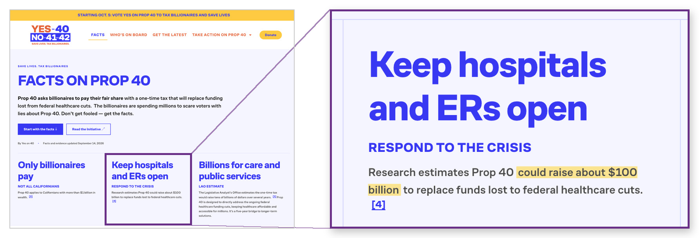</div>
</div>
<div class="camp-col" style="--c:#1f6b3b">
<div class="camp-head"><div><div class="camp-k">Against: cites the JR analysis (March 2026)</div><div class="camp-n">&ldquo;$25 billion in lost revenue&rdquo;</div></div></div>
<div class="camp-shot">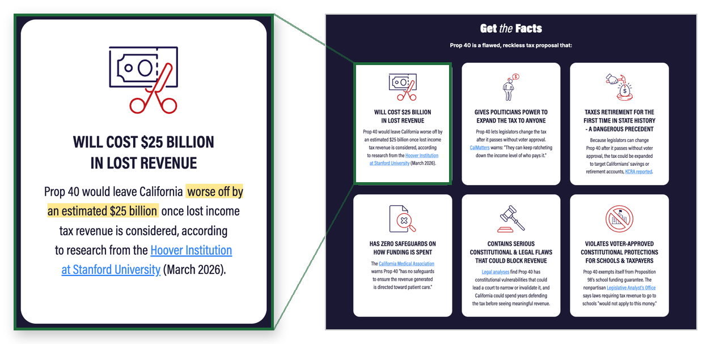</div>
</div>
</div>

.footnote[Arguments from the official voter guide: California Secretary of State, *Official Voter Information Guide*, general election of 3 November 2026, Proposition 40, [argument in favor (p.56) and argument against (p.57)](https://voterguide.sos.ca.gov/propositions/40/arguments-rebuttals.htm). Campaign pages [yeson40.com/facts](https://yeson40.com/facts/) and [votenoon40.org](https://votenoon40.org/), captured 18 October 2026; highlights added.]

---
name: why-opa-3
class: head-small, opa3-tight

# What is the problem with multiple analyses?

```{css, echo=FALSE}
/* why-opa-3: pull the text and figures up so the arrow line clears the footnote,
   without shrinking the figures themselves (author rule 2026-10-30).
   A custom class, not the auto id, because remark.js only tags the FIRST
   incremental build fragment with the name-derived id; the class from
   "class:" propagates to every fragment of an incremental slide. */
.opa3-tight { padding-top: 0.3em; }
.opa3-tight h1 { margin: 0 0 0.1em; }
.opa3-tight .pull-left, .opa3-tight .pull-right { margin-top: 0; font-size: 90%; }
.opa3-tight .pull-left p, .opa3-tight .pull-right p { margin-bottom: 0.15em; }
.opa3-tight .center { margin-top: 0; }
.opa3-tight .center img { margin-bottom: -0.8em; }
```

.pull-left[
One analysis gives every decision maker the same starting facts. Their choices then show what each of them truly values.

.center[]
]

.pull-right[
Each decision maker picks the analysis that fits. We see which facts they chose, but we learn nothing about what they value.

.center[]
]

--

&rarr; Multiple policy analyses of the same quantity contribute to alternative facts<sup>1</sup>

.footnote[<sup>1</sup> What Manski calls *dueling certitudes*: rival analyses that each report one number with confidence and reach opposite conclusions (Charles F. Manski, ["Policy Analysis with Incredible Certitude"](https://doi.org/10.1111/j.1468-0297.2011.02457.x), *The Economic Journal*, 2011).]

---
name: why-opa-4
class: head-beside, head-small

# From alternative facts to one common estimate

.fig-pinned.fig-split[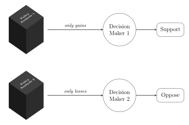]

--

.beside[
**With transparency: Open Policy Analysis (OPA)**<sup>1</sup>

- <b style="color:#d4880f">Open output</b>: one main estimate, with each main assumption as an input that the reader can move.
- <b style="color:#1484c5">Open analysis</b>: every step from the inputs to that estimate, written out in prose, equations and code, with the guesswork marked.
- <b style="color:#0b4a7c">Open materials</b>: the data, code and tests that rerun it.
]

.fig-pinned.fig-split[]

.footnote.beside[<sup>1</sup> Hoces de la Guardia, F., Grant, S. and Miguel, E. (2021), ["A framework for open policy analysis"](https://doi.org/10.1093/scipol/scaa067), *Science and Public Policy*.]

---
name: why-opa-7
class: head-beside

# This is what this project does

.beside[
- This project seeks to move policy analysis in this direction, using the example of a wealth tax proposal for California known as Proposition 40.
- It builds three Open Policy Analyses on top of the two main original analyses used in the debate on this policy: Boll, Saez and Zucman (2026), **BSZ**, and Jaros and Rauh (2026), **JR**.<sup>1</sup>
- The comparison does not pick the most credible estimate. It shows which components drive the gap.
]

.footnote.beside[<sup>1</sup> Boll, J., Saez, E. and Zucman, G. (2026), ["California Billionaires: Wealth, Taxes, and Wealth Tax Revenue Estimates"](https://www.nber.org/papers/w35218), NBER Working Paper 35218, August. Jaros, B. and Rauh, J. (2026), ["The Net Present Value of the California Billionaire Tax Act"](https://www.nber.org/system/files/chapters/c15504/c15504.pdf), NBER chapter c15504, *Tax Policy and the Economy* 41, September.]

.fig-pinned.fig-split.fig-tall[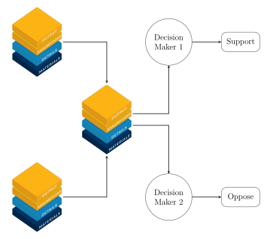]

<div class="opa-labels">
<a class="opa-label" style="left:46.4%; top:37%;" href="../../bsz-analysis/site/explorer/">The BSZ analysis</a>
<a class="opa-label" style="left:46.4%; bottom:31%;" href="../../rjkdc-analysis/site/explorer/">The JR analysis</a>
<a class="opa-label opa-label-left" style="right:45%; top:53%;" href="../../comparison/site/explorer/">The comparison</a>
</div>


---
name: ai-opa
class: big-bullets


```{css, echo=FALSE}
.remark-code, .remark-inline-code { font-size: 80%; }
.remark-slide-content { padding: 1em 2em; }
.small { font-size: 80%; }
/* A figure at a fixed height, so it stays in place when the heading above wraps (slides why-opa, why-opa-2 and why-opa-4 to why-opa-6, so the decision makers stay in place). */
.fig-pinned { position: absolute; top: 27%; bottom: 4%; right: 3%; text-align: right; }
.fig-pinned img { height: 100%; width: auto; }
/* Slides why-opa-4 and why-opa-5: the figure drawn twice, its top half raised by 30% of the
   figure's height and its bottom half lowered by 5%, so the two rows sit further apart. */
.fig-split img { position: absolute; top: 0; right: 0; }
.fig-split img.half-bottom { clip-path: inset(50% 0 0 0); transform: translateY(5%); }
.fig-split img.half-top { clip-path: inset(0 0 50% 0); transform: translateY(-30%); }
.fig-split { left: 0; }
.fig-split img { max-width: none; }
/* why-opa-6: the third-OPA figure already has slide why-opa-5's rows; its image is 135% as tall
   and starts 30% higher (rows placed by the figure's build to match), so it is drawn at that size and offset to line up with why-opa-5. */
.fig-tall img { height: 135%; top: -30%; }
/* why-opa-7: a link label on each OPA of the figure, to that OPA's overview page. Positions are
   measured on the rendered slide: under the top icon, over the bottom one, left of the middle one. */
.opa-labels { position: absolute; top: 0; left: 0; width: 100%; height: 100%; pointer-events: none; }
.opa-label { position: absolute; transform: translateX(-50%); pointer-events: auto; white-space: nowrap;
  font-size: 0.8em; font-weight: 600; }
.opa-label-left { transform: translateY(-50%); }
/* A button in the lower-right corner, above the slide number: links to appendix slides and back. */
.corner-btn { position: absolute; right: 2em; bottom: 48px; font-size: 75%; font-weight: 600;
  padding: 0.3em 0.8em; border: 1px solid #1d4e89; border-radius: 4px; text-decoration: none; }
/* contents: the deck's table of contents; parts already covered are greyed. */
.toc { font-size: 130%; margin-top: 1.2em; }
.toc li { margin-bottom: 0.7em; }
.toc-done { color: #999; }
.toc-note { color: #999; font-size: 75%; }
/* opa-bsz, opa-jr, opa-comparison: text left, the overview's before-and-after figures right. */
.opa-card .pull-left { font-size: 85%; }
.cmp { display: flex; align-items: center; gap: 6px; margin-top: 30px; }
.cmp-fig { flex: 1 1 0; text-align: center; }
.cmp-fig svg { width: 100%; height: auto; }
.cmp-kicker { display: block; font-size: 70%; font-weight: 600; letter-spacing: .06em; text-transform: uppercase; color: #666; margin-bottom: 4px; }
.cmp-arrow { font-size: 160%; color: #999; }
/* one figure alone (the comparison card): the size of one of a pair */
.cmp-one .cmp-fig { flex: 0 1 50%; margin: 0 auto; }
/* disclosure: the overview's credit table at slide size. */
.ai-badge.inline { font-size: 0.72em; margin-left: 0.1em; vertical-align: 0.05em; }
/* pseudo-eq: the four terms, one slide each. */
.eq-list { margin: -0.6em 0 0.2em 1.2em; line-height: 1.3; }
/* verification: the strategies by OPA. */
.verif { width: 100%; font-size: 80%; margin-top: 10px; }
table.dt.verif th { vertical-align: bottom; text-align: left; }
table.dt.verif td { vertical-align: top; text-align: left; padding: 8px 10px; }
/* layer-*: the appendix's layer slides, the layer figure and text left, a screenshot right
   (figs/layers/, taken by screenshots.sh). */
.layer-slide .pull-left { width: 31%; font-size: 80%; }
.layer-slide .pull-right { width: 65%; }
.layer-fig { display: block; height: 150px; margin: 0 auto 6px; }
.layer-shot img { width: 100%; border: 1px solid #ccc; box-shadow: 0 1px 4px rgba(0,0,0,.15); }
.ai-use-slide table.ai-use { width: 100%; font-size: 70%; border-collapse: collapse; }
.ai-use-slide table.ai-use th, .ai-use-slide table.ai-use td { text-align: left; padding: 4px 8px; border-bottom: 1px solid #e4e4e4; }
.ai-use-slide .table-subhead { font-size: 75%; color: #666; }
.ai-use-slide .sq { display: inline-block; width: 13px; height: 13px; margin-right: 3px; border-radius: 2px; vertical-align: -1px; }
.ai-use-slide .sq.h { background: var(--credit-h); }
.ai-use-slide .sq.ai { background: var(--credit-ai); }
.ai-use-slide .sq.eq { background: linear-gradient(135deg, var(--credit-h) 50%, var(--credit-ai) 50%); }
.ai-use-slide .sqs { display: block; white-space: nowrap; }
.ai-use-slide .meter { display: inline-block; margin-right: 6px; white-space: nowrap; }
.ai-use-slide .pip { display: inline-block; width: 10px; height: 10px; margin-right: 2px; border-radius: 50%; border: 1.5px solid #666; vertical-align: 0; }
.ai-use-slide .pip.on { background: #111; border-color: #111; }
.ai-use-slide .ai-key { font-size: 60%; color: #444; margin: 8px 0 0; line-height: 1.7; }
.ai-use-slide .ai-key span { margin-right: 14px; white-space: nowrap; }
/* ai-opa: larger bullets, a little apart. */
.big-bullets ul { font-size: 125%; }
.big-bullets li { margin-bottom: 0.5em; }
.big-bullets ul ul, .mid-bullets ul ul { font-size: 100%; }
/* ai-challenges: a little larger than the default, with sub-bullets. */
.mid-bullets > ul, .mid-bullets .remark-slide-content > ul { font-size: 105%; }
.mid-bullets li { margin-bottom: 0.3em; }
/* The verification slide: three small OPA icons in a row. */
.opa-trio { display: flex; justify-content: center; gap: 7%; margin: 0.2em 0 0.6em; }
.opa-trio figure { margin: 0; text-align: center; }
.opa-trio img { height: 120px; }
.opa-trio figcaption { font-size: 70%; margin-top: 0.2em; }
/* prop40: the newspaper quote, set apart from the bullets. */
.quote-box { margin-top: 0.6em; padding: 0.2em 0.9em; border-left: 4px solid #999; color: #444; font-style: italic; font-size: 80%; }
.quote-box p { margin: 0.2em 0; }
.quote-src { font-style: normal; font-size: 85%; }
/* prop40: each campaign's claim over a panel built from clean captures of its page
   (figs/prop40/clean/make_clean_panels.py, captured 2026-10-18): logo and voter-guide quote on top,
   the page small with a rectangle round the quoted block, the block enlarged beside it, the
   sentence marked with a highlighter band added before the capture. */
.camp { display: flex; gap: 22px; margin-top: 12px; }
.camp-col { flex: 1 1 0; display: flex; flex-direction: column; }
.camp-head { display: flex; align-items: center; gap: 10px; border-top: 4px solid var(--c); padding-top: 6px; margin-bottom: 7px; }
.camp-logo { height: 33px; width: auto; border-radius: 2px; }
.camp-k { font-size: 9px; letter-spacing: .12em; text-transform: uppercase; color: #555; font-weight: 700; }
.camp-n { font-size: 17px; font-weight: 700; line-height: 1.15; }
.camp-shot { display: flex; justify-content: center; }
.camp-panel { display: block; max-width: 100%; max-height: 225px; width: auto; height: auto; }
/* On why-opa-4 the heading wraps in the left column, clear of the raised top row. */
.head-beside h1 { width: 36%; }
.head-beside .beside, .head-beside .footnote.beside { width: 35%; }
/* Text beside a right-justified pinned figure: a left column that stops short of it. */
.beside { width: 40%; }
.footnote.beside { width: 40%; }
/* why-opa-5: the bullets centred vertically on the slide, one blank line apart. */
.beside.mid { position: absolute; top: 50%; transform: translateY(-50%); left: 3.3%; }
.beside.mid li { margin-bottom: 1em; }
.beside.mid li:last-child { margin-bottom: 0; }
/* why-opa-5: its title wraps to four lines in the column, so the bullets sit below it. */
.remark-slide-content.head-small h1 { font-size: 44px; }
.head-beside .beside.mid { top: 63%; }
/* The summary slide: a heading and four bullets, centred between the title and the bottom. */
.summary .beside.mid { top: 58%; }
.tiny { font-size: 65%; }
.highlight-box {
  border-left: 1px solid #666666;
  padding: 0.5em 1em;
  margin: 0.5em 0;
}
.blue-box {
  border-left: 1px solid #666666;
  padding: 0.5em 1em;
  margin: 0.5em 0;
}
.site-nav {
  font-size: 11px;
  color: #5b6873;
  margin: 0 0 14px;
}
.site-nav a { color: #1d4e89; text-decoration: none; }
.site-nav a:hover { text-decoration: underline; }

.remark-slide-content.opa-slide { position: relative; z-index: 0; overflow: hidden; }
/* Author credit, pinned near the slide's lower-left corner, above the fixed
   "Overview" link that the header script places in that corner. */
.opa-slide .credit {
  position: absolute; left: 2em; bottom: 48px; font-size: 65%; color: #5b6873;
}
.opa-slide .credit a { color: #1d4e89; }
.opa-intro { font-size: 92%; max-width: 30em; margin: 0 auto 1.1em; }
.opa-legend { font-size: 85%; line-height: 1.75; max-width: 34em; margin: 0 auto;
              text-align: left; }
.opa-intro a, .opa-legend a { color: #1d4e89; }
.opa-mark {
  position: absolute; top: 26px; right: 34px; height: 190px; width: auto;
  opacity: 0.218; z-index: -1; pointer-events: none;
}
.two { display: flex; gap: 2em; }
.two > div { flex: 1; }
.big { font-size: 180%; font-weight: 600; margin: 0.1em 0; }
table.dt { border-collapse: collapse; width: 100%; font-size: 80%; margin-top: 0.5em; }
table.dt td, table.dt th { padding: 4px 8px; border-bottom: 1px solid #e2e7ec; text-align: right; }
table.dt td:first-child, table.dt th:first-child { text-align: left; }
table.dt tr.tot td { font-weight: 600; border-top: 2px solid #5b6873; }
table.dt th { background: none; }
.og { font-size: 80%; padding: 1px 6px; border: 1px dashed #444444; color: #444444; white-space: nowrap; }
.og.data { border-style: solid; }
.og.scenario { border-color: transparent; font-style: italic; }
.footnote { font-size: 60%; color: #5b6873; bottom: 3.6em; left: 3.4em; padding-right: 6em; }
.pseudo-eq { display: flex; flex-wrap: wrap; align-items: flex-start; justify-content: center;
             gap: 6px 8px; margin: 0.8em 0 0.6em; }
.pseudo-eq .term { display: inline-flex; flex-direction: column; align-items: center;
                   min-width: 4.5em; max-width: 7.2em; text-align: center;
                   padding: 4px 6px; }
.pseudo-eq .term b { font-size: 120%; font-weight: 600; }
.pseudo-eq .term small { font-size: 62%; color: #5b6873; line-height: 1.3; }
.pseudo-eq .op { font-size: 130%; color: #5b6873; padding-top: 8px; }
.pseudo-eq .run { font-size: 58%; color: #5b6873; white-space: nowrap; }
.pseudo-eq .eq-step { display: inline-flex; align-items: flex-start; gap: 8px; }
.claims { font-size: 85%; }
.claims td, .claims th { vertical-align: top; text-align: left !important; }
table.dt td.l, table.dt th.l { text-align: left; }
.nb { white-space: nowrap; }
/* The smaller-steps slide: a tighter table so its four notes fit under it. */
.remark-slide-content.tight-table table.dt { font-size: 72%; margin-top: 0.3em; }
.remark-slide-content.tight-table table.dt td, .remark-slide-content.tight-table table.dt th { padding: 2px 6px; }
```

# Artificial intelligence and Open Policy Analysis

- Open Policy Analysis has been around for several years (Hoces de la Guardia, 2017; Hoces de la Guardia, Grant and Miguel, 2021).<sup>1</sup>
- Several organizations have moved to increase transparency in documentation, materials and visualizations, but none to the degree proposed in the original framework.
- One explanation could be the cost of generating an OPA. Previous prototypes took **several months of work to generate one** OPA.
- With the help of agentic coding, the cost of generating an OPA has dropped substantially. This project created **three OPAs in about a week** of work.

.footnote[<sup>1</sup> Hoces de la Guardia, F. (2017), "How Transparency and Reproducibility Can Connect Research and Policy: A Case Study of the Minimum Wage Policy Estimates", PhD dissertation, Pardee RAND Graduate School. Hoces de la Guardia, F., Grant, S. and Miguel, E. (2021), ["A framework for open policy analysis"](https://doi.org/10.1093/scipol/scaa067), *Science and Public Policy*.]


---
name: ai-challenges
class: mid-bullets, ai7-tight

# The challenges of AI for OPA

```{css, echo=FALSE}
/* ai-challenges: close the gap between the title and the column headers, and
   fit the closing bullets at normal size instead of shrinking them (author
   rules 2026-10-30). A custom class, since it must survive incremental
   builds if any are added later (see why-opa-3's .opa3-tight for why). */
.ai7-tight h1 { margin-bottom: 0.45em; }
.ai7-tight .pull-left, .ai7-tight .pull-right { margin-top: 0; }
.ai7-tight .pull-left h3, .ai7-tight .pull-right h3 { margin: 0 0 0.3em; }
/* the question under each header: the same height in both columns, so the two lists start level */
.ai7-tight .pull-left p, .ai7-tight .pull-right p { margin: 0 0 0.35em; min-height: 2.6em; }
.ai7-tight .pull-left ol, .ai7-tight .pull-right ul { margin-top: 0; }
.ai7-tight .pull-left li, .ai7-tight .pull-right li { margin-bottom: 0.3em; }
/* the two closing bullets: full width, below both columns */
.ai7-tight > ul { clear: both; margin-top: 1.4em; }
.ai7-tight > ul > li { margin-bottom: 0.35em; }
```

.pull-left[
### Verification

**Is the reproduction correct?**

  1. Running the paper's robustness cases through the OPA, to see if it generates the same results.
  2. Estimating, in the OPA, settings the paper does not print, and asking the authors to run them in their own model to check they get the same results.
  3. A thorough review of each layer, to confirm that the output is accurate.
]

--

.pull-right[
### Intelligibility
**Are the exposition, methods and code easy to digest for different audiences?**
- Strong parallels with how the field of mathematics is evolving alongside AI.
- AI-generated proofs can be verified using software (Lean). OPAs can be verified using strategies 1 to 3 above.
- Both fields require much human effort in "digesting"<sup>1</sup> the explanations.
]

.footnote[<sup>1</sup> Terence Tao, ["Mathematics in the age of AI"](https://teorth.github.io/tao-web/slides/age-of-ai-icm-2026.pdf), public lecture, International Congress of Mathematicians, 2026: on "proof indigestion," the widening gap between generating, verifying and digesting proofs.]

--

- An OPA built by the original authors is much easier to verify than one built by outsiders, as here.
- Here we adopt a combination of 1, 2 and 3, and disclose for each component what has been AI generated, reviewed and verified. Each analysis's pages carry a badge that says how far they have been reviewed.


---
name: verification
class: head-small, credit-slide

# The verification and review of these three OPAs

```{r credit-build-fns, include=FALSE}
stopifnot(bsz_checks$match == bsz_checks$n, jr_checks$match == jr_checks$n)

# An overview page's credit table and its key, read from the built page so the slides always
# match it. credit_table() draws one page's table whole (the appendix uses it for the JR analysis
# and the comparison); credit_build() draws all three, row by row, for the build on this slide.
credit_table <- function(page) {
  ov <- paste(readLines(file.path(root, page), warn = FALSE), collapse = "\n")
  tab <- regmatches(ov, regexpr('(?s)<table class="ai-use">.*?</table>', ov, perl = TRUE))
  key <- regmatches(ov, regexpr('(?s)<div class="ai-key">.*?</div>\\s*</div>', ov, perl = TRUE))
  stopifnot(length(tab) == 1, length(key) == 1)
  tab <- sub('<span class="table-subhead">this page</span>', '<span class="table-subhead">the overview</span>', tab, fixed = TRUE)
  cat('<div class="ai-use-slide">', gsub("\n\\s*", " ", tab), gsub("\n\\s*", " ", key), "</div>")
}

credit_rows <- function(page, opa) {
  ov <- paste(readLines(file.path(root, page), warn = FALSE), collapse = "\n")
  tab <- regmatches(ov, regexpr('(?s)<table class="ai-use">.*?</table>', ov, perl = TRUE))
  rows <- regmatches(tab, gregexpr("(?s)<tr>.*?</tr>", tab, perl = TRUE))[[1]][-1]   # drop the header row
  stopifnot(length(rows) == 5)
  lapply(rows, function(r) {
    cells <- regmatches(r, gregexpr("(?s)<td>.*?</td>", r, perl = TRUE))[[1]]
    stopifnot(length(cells) == 5)
    cells <- gsub("</?td>", "", cells)
    list(opa = opa, object = sub("<br>.*", "", cells[1]),
         layer = sub('.*<span class="table-subhead">(.*?)</span>.*', "\\1", cells[1]),
         cells = cells[2:5],
         titles = vapply(cells[2:5], function(cc) sub('.*title="([^"]*)".*', "\\1", cc), ""))
  })
}
CREDIT <- c(credit_rows("bsz-analysis/site/index.html", "The BSZ analysis"),
            credit_rows("rjkdc-analysis/site/index.html", "The JR analysis"),
            credit_rows("index.html", "The comparison"))
credit_key <- local({
  ov <- paste(readLines(file.path(root, "bsz-analysis/site/index.html"), warn = FALSE), collapse = "\n")
  gsub("\n\\s*", " ", regmatches(ov, regexpr('(?s)<div class="ai-key">.*?</div>\\s*</div>', ov, perl = TRUE)))
})
# The layer each object belongs to, in the colours slide 4 gives the three layers; the overview
# page is not a layer, so it is grey.
LAYER_COL <- c("Open Output" = "#d4880f", "Open Analysis" = "#1484c5", "Open Materials" = "#0b4a7c", "this page" = "#9a9a9a")
layer_name <- function(l) if (l == "this page") "the overview" else l

# step 1: the three icons only; 2: the rows, empty; 3: the first row filled; 4: every row filled.
# Every state draws every cell (hidden ones invisible, not absent) so nothing moves between clicks.
# layout "wide" fills the slide's width and leaves room at the bottom; "tall" fills the height and
# leaves room on the right (author request 2026-10-30, two designs to choose from).
CREDIT_LAYOUT <- "wide"
OPA_LABELS <- c("The BSZ analysis" = "BSZ", "The JR analysis" = "JR", "The comparison" = "compar&shy;ison")
credit_build <- function(step, layout = CREDIT_LAYOUT) {
  vis <- function(show, html) if (show) html else sprintf('<span style="visibility:hidden">%s</span>', html)
  hdr <- c("Object", "Ideas and<br>direction", "Doing<br>the work", "Writing", "Human<br>verification")
  out <- sprintf('<div class="ai-use-slide credit-build step%d lay-%s"><table class="ai-use"><tr><th></th><th></th>%s</tr>', step, layout,
                 paste(sprintf("<th>%s</th>", vapply(hdr, function(h) vis(step >= 2, h), "")), collapse = ""))
  for (i in seq_along(CREDIT)) {
    r <- CREDIT[[i]]
    icon <- if ((i - 1) %% 5 == 0) sprintf('<td class="opa-lab" rowspan="5">%s</td><td class="opa-ico" rowspan="5">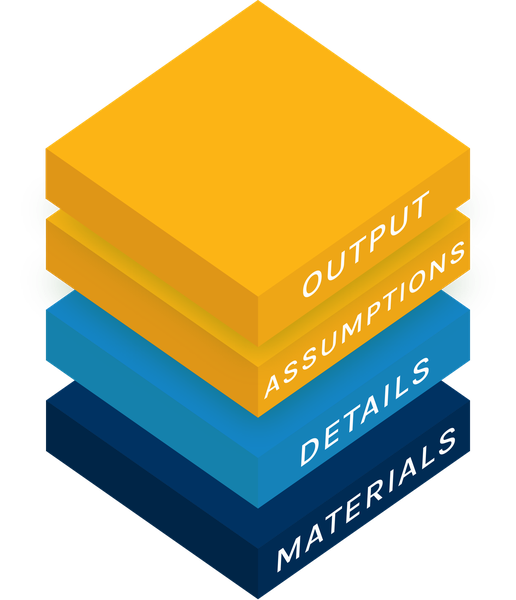</td>', OPA_LABELS[[r$opa]]) else ""
    chip <- sprintf('<i class="layer-chip" style="background:%s" title="%s"></i>', LAYER_COL[[r$layer]], layer_name(r$layer))
    filled <- step >= 4 || (step >= 3 && i == 1)
    out <- c(out, sprintf("<tr>%s<td>%s</td>%s</tr>", icon, vis(step >= 2, paste0(chip, r$object)),
                          paste(sprintf("<td>%s</td>", vapply(r$cells, function(cc) vis(filled, cc), "")), collapse = "")))
  }
  cat(c(out, "</table></div>"), sep = "\n")   # one row per line: a single very long line trips knitr's regexes
}

# The worked example beside the table: the first row, read out from its own tooltips.
credit_example <- function() {
  r <- CREDIT[[1]]
  groups <- vapply(r$titles[1:3], function(t) sub("; not applicable:.*$", "", t), "")
  cat('<div class="credit-right ai-use-slide"><p><b>Reading the first row</b>, the explorer of the BSZ analysis. The chip is the layer the object belongs to, in the icon&rsquo;s colours (grey: the overview page). Then one square per CRediT role, coloured by who led it:</p><ul>',
      paste(sprintf("<li>%s.</li>", groups), collapse = ""),
      sprintf('<li><b>Human verification</b>, this OPA&rsquo;s addition: how closely the author has checked the object. Here: %s.</li>', tolower(r$titles[4])),
      "</ul>", credit_key, "</div>", sep = "\n")
}
```

```{css, echo=FALSE}
/* verification, the build: the table on the left, the worked example on the right, and the
   bottom of the slide kept clear for one closing sentence. */
.credit-slide h1 { margin-bottom: 0.25em; }
.credit-slide > ul { margin: 0 0 0.2em; font-size: 92%; }
.credit-slide .review-lead { margin: 0.2em 0 0.1em; font-weight: 600; font-size: 92%; }
.credit-slide .credit-build { float: left; width: 62%; }
.credit-slide .credit-right { float: right; width: 35%; font-size: 72%; line-height: 1.35; }
.credit-slide .credit-right p { margin: 0 0 0.3em; }
.credit-slide .credit-right ul { margin: 0 0 0.4em 1.1em; padding: 0; }
.credit-slide .credit-right li { margin-bottom: 0.15em; }
.credit-slide .credit-right .ai-key { font-size: 88%; line-height: 1.5; }
.credit-build table.ai-use { font-size: 58%; }
.credit-build table.ai-use th, .credit-build table.ai-use td { padding: 1px 6px; line-height: 1.2; white-space: nowrap; }
.credit-build td.opa-lab { font-weight: 600; text-align: right; vertical-align: middle; width: 5em; padding-right: 2px; line-height: 1.1; }
.credit-build td.opa-ico { text-align: center; vertical-align: middle; width: 80px; padding: 2px; }
.credit-build td.opa-ico img { width: auto; display: block; margin: 0 auto; }
/* design A, "wide": the table spans the slide, the bottom stays clear for one sentence */
.credit-slide .credit-build.lay-wide { float: none; width: 100%; }
.credit-build.lay-wide table.ai-use { font-size: 64%; }
.credit-build.lay-wide table.ai-use th, .credit-build.lay-wide table.ai-use td { padding: 1px 8px; }
.credit-build.lay-wide td.opa-ico img { height: 62px; }
.credit-build.lay-wide .sq { width: 13px; height: 13px; margin-right: 3px; }
.credit-build.lay-wide .pip { width: 11px; height: 11px; }
/* design B, "tall": the table runs to the bottom of the slide, the right stays clear */
.credit-slide .credit-build.lay-tall { float: none; width: 74%; }
.credit-build.lay-tall table.ai-use { font-size: 70%; }
.credit-build.lay-tall table.ai-use th, .credit-build.lay-tall table.ai-use td { padding: 2px 8px; }
.credit-build.lay-tall td.opa-ico img { height: 74px; }
.credit-build.lay-tall .sq { width: 14px; height: 14px; margin-right: 3px; }
.credit-build.lay-tall .pip { width: 12px; height: 12px; }
.credit-build .layer-chip { display: inline-block; width: 10px; height: 10px; border-radius: 2px; margin-right: 6px; vertical-align: -1px; }
.credit-build.step1 table.ai-use th, .credit-build.step1 table.ai-use td { border-color: transparent; }
.credit-build .sq { width: 11px; height: 11px; margin-right: 2px; }
.credit-build .pip { width: 9px; height: 9px; }
```

- **Results the papers print**, rerun in each OPA: all match ([BSZ `r bsz_checks$match` of `r bsz_checks$n`](../../bsz-analysis/site/checks.html#results), [JR `r jr_checks$match` of `r jr_checks$n`](../../rjkdc-analysis/site/checks.html#results)).
- **Estimates the papers do not print**, sent to the authors to run in their own models: `r bsz_settings` settings to the BSZ team, `r jr_settings` to the JR team.

---
name: verification-2
count: false
class: head-small, credit-slide

# The verification and review of these three OPAs

- **Results the papers print**, rerun in each OPA: all match ([BSZ `r bsz_checks$match` of `r bsz_checks$n`](../../bsz-analysis/site/checks.html#results), [JR `r jr_checks$match` of `r jr_checks$n`](../../rjkdc-analysis/site/checks.html#results)).
- **Estimates the papers do not print**, sent to the authors to run in their own models: `r bsz_settings` settings to the BSZ team, `r jr_settings` to the JR team.

.review-lead[The review: every object of the three OPAs, who did what and how far the author checked it.]

```{r credit-build-1, results="asis"}
credit_build(1)
```

---
name: verification-3
count: false
class: head-small, credit-slide

# The verification and review of these three OPAs

- **Results the papers print**, rerun in each OPA: all match ([BSZ `r bsz_checks$match` of `r bsz_checks$n`](../../bsz-analysis/site/checks.html#results), [JR `r jr_checks$match` of `r jr_checks$n`](../../rjkdc-analysis/site/checks.html#results)).
- **Estimates the papers do not print**, sent to the authors to run in their own models: `r bsz_settings` settings to the BSZ team, `r jr_settings` to the JR team.

.review-lead[The review: every object of the three OPAs, who did what and how far the author checked it.]

```{r credit-build-2, results="asis"}
credit_build(2)
```

---
name: verification-4
count: false
class: head-small, credit-slide

# The verification and review of these three OPAs

- **Results the papers print**, rerun in each OPA: all match ([BSZ `r bsz_checks$match` of `r bsz_checks$n`](../../bsz-analysis/site/checks.html#results), [JR `r jr_checks$match` of `r jr_checks$n`](../../rjkdc-analysis/site/checks.html#results)).
- **Estimates the papers do not print**, sent to the authors to run in their own models: `r bsz_settings` settings to the BSZ team, `r jr_settings` to the JR team.

.review-lead[The review: every object of the three OPAs, who did what and how far the author checked it.]

```{r credit-build-3, results="asis"}
credit_build(3)
```

---
name: disclosure
count: false
class: head-small, credit-slide

# The verification and review of these three OPAs

- **Results the papers print**, rerun in each OPA: all match ([BSZ `r bsz_checks$match` of `r bsz_checks$n`](../../bsz-analysis/site/checks.html#results), [JR `r jr_checks$match` of `r jr_checks$n`](../../rjkdc-analysis/site/checks.html#results)).
- **Estimates the papers do not print**, sent to the authors to run in their own models: `r bsz_settings` settings to the BSZ team, `r jr_settings` to the JR team.

.review-lead[The review: every object of the three OPAs, who did what and how far the author checked it.]

```{r credit-build-4, results="asis"}
credit_build(4)
```

<!-- Space below the table is kept for one closing sentence (text to come from the author). -->
---
name: backup
class: center, middle

# Backup

---

name: why-opa

# Why do we need Open Policy Analysis?

.beside[
- Researchers, government agencies and think tanks produce **policy analyses**. These estimate the costs and benefits of a proposed policy from the best available research.
- A policy analysis reports positive (empirical) quantities. It does not judge whether those costs and benefits are good or bad.
- Decision makers can use the same analysis and still decide differently, because they value the same facts differently.
]

.fig-pinned[]

---
name: why-opa-2

# Why do we need Open Policy Analysis?

.beside[Often there are **competing analyses**, and each decision maker cites the one that fits. Proposition
40 has two, and they disagree on the sign: one finds a gain in revenue, the other a loss. A reader
sees two conflicting results and cannot tell which assumptions produce the gap. An Open Policy Analysis makes each one checkable, from the output to the code.]

.fig-pinned[]

---
name: why-opa-6
class: head-beside

# With transparency

.beside[Once we can thoroughly appraise each policy analysis, we can understand their differences and
build a third OPA that bridges the two, one input at a time. This lays the foundations for resolving the differences and
moving closer to a common reality.]

.fig-pinned.fig-split.fig-tall[]


---
name: opa-bsz
class: opa-card

# The BSZ analysis OPA

.pull-left[
Boll, Saez and Zucman estimate the one-time tax at about $100 billion of wealth tax. This OPA rebuilds their Table 5 from the authors' public workbook, in R with a Python twin and tests, and nets the income tax effects into one main estimate of `r usd(eb$bsz_model)`.

**What reproduces.** The authors' workbook and this code reproduce the published results. `r cap1(n_words(bsz_notes))` notes on where the paper's text, tables and workbook describe a step differently are kept for transparency; none is a failure to reproduce. Every variation the paper prints reproduces (`r bsz_checks$match` of `r bsz_checks$n`). `r cap1(n_words(bsz_settings))` settings the paper does not print have been sent to the authors to test. [Checks](../../bsz-analysis/site/checks.html)

[The BSZ analysis overview](../../bsz-analysis/site/)

<a class="corner-btn" href="#layer-bsz-output">Its layers, with screenshots &rarr;</a>
]

.pull-right[
```{r cmp-bsz, results="asis"}
compare_figs("bsz-analysis/site/index.html")
```
]

---
name: opa-jr
class: opa-card

# The JR analysis OPA

.pull-left[
Jaros and Rauh find a mean net present value of `r usd(rj_print)`: the wealth tax minus the income tax lost for ever when billionaires leave. This OPA reruns the authors' own code as shipped, in R with a Python twin and tests, and computes the exact average of their Monte Carlo, `r usd(rj_main, 2)`.

**What reproduces.** The authors' code reproduces the published results. `r cap1(n_words(jr_notes))` notes on where their text, READMEs and code describe a step differently are kept for transparency; none is a failure to reproduce. Every variation the papers print reproduces (`r jr_checks$match` of `r jr_checks$n`). `r cap1(n_words(jr_settings))` settings the papers do not print have been sent to the authors to test. [Checks](../../rjkdc-analysis/site/checks.html)

[The JR analysis overview](../../rjkdc-analysis/site/)

<a class="corner-btn" href="#layer-jr-output">Its layers, with screenshots &rarr;</a>
]

.pull-right[
```{r cmp-jr, results="asis"}
compare_figs("rjkdc-analysis/site/index.html")
```
]

---
name: opa-comparison
class: opa-card

# The comparison OPA

.pull-left[
The comparison puts both analyses on one common output, the net fiscal effect (the wealth tax, plus income tax from asset sales, minus the present value of income tax lost), and moves from one main estimate to the other one disputed input at a time.<sup>1</sup> Its explorer lets a reader set each input to either analysis's value.

**What reproduces.** Both main estimates are rebuilt on the common output from the two analyses' exported files, `r usd(eb$bsz_model)` and `r usd(rj_main)`. Each step of the bridge is the change from moving one explorer dial, in R and in the browser (the steps add up to the gap by construction). The R and Python versions agree.

[The comparison overview](../../index.html)

<a class="corner-btn" href="#layer-cmp-output">Its layers, with screenshots &rarr;</a>
]

.pull-right[
```{r cmp-comparison, results="asis"}
# the comparison's overview has no "Difference" figures; its layers are the same as the BSZ OPA's
compare_figs("bsz-analysis/site/index.html", only = 2)
```
]

.footnote.beside[<sup>1</sup> A previous comparison, Hoopes, J. L. (2026), ["Galle v Rauh: Comparing Two Revenue Estimates for California Billionaire Taxation"](https://papers.ssrn.com/sol3/papers.cfm?abstract_id=6428578), SSRN Working Paper 6428578, uses earlier versions of both analyses. [The appendix](#hoopes) sets its steps beside this bridge.]


---
name: pseudo-eq

# What separates the two numbers

.small[
Both estimates are on one measure, output (b), the net fiscal effect. It is the wealth tax, plus
income tax from assets sold to pay it, minus income tax lost to people who leave. The equation
moves the explorer's BSZ panel dials one at a time to the JR values, in the order shown (the dial
path). Each amount is what its dials change.
]

```{r pseudo, results="asis"}
# D and q of the dial path, the loss box's four steps added up, then the other three added up
# (eq_terms() in R/site.R; the same equation as the explorer and the overview)
et <- eq_terms(dp)
# The order-free ranking: the report's order-free check (Shapley values, export/r/bridge.csv,
# own horizon, output (b)), the three inputs with the largest average step, largest first. A dial
# is named by its symbol and its name (DIAL_SYMBOLS, DIAL_NAMES in R/site.R); a minor input,
# which has no dial of its own, by its title.
sh_ids <- bb$step_id[order(-abs(bb$shapley))][1:3]
sh_name <- function(id) if (id %in% names(DIAL_SYMBOLS)) sprintf("*%s* (%s)", DIAL_SYMBOLS[[id]], DIAL_NAMES[[id]]) else
  tolower(steps$title[steps$step_id == id])
sh_three <- vapply(sh_ids, sh_name, "")
sh_three <- paste0(paste(head(sh_three, -1), collapse = ", "), " and ", tail(sh_three, 1))
# On the deck the four terms are numbered (i) to (iv), the order the next slides take them in,
# in place of the dial letters the overview and the explorer print.
et$terms$label <- paste0(sub(" [(][^)]*[)]$", "", et$terms$label), " (", c("i", "ii", "iii", "iv"), ")")
stopifnot(nrow(et$terms) == 4)
term <- function(j) with(et$terms[j, ], sprintf('<span class="eq-step"><span class="op">%s</span><span class="term"><b>%s</b><small>%s</small></span></span>',
                            if (change < 0) "&minus;" else "+", money(abs(change), 2), esc(label)))
cat('<div class="pseudo-eq">',
    sprintf('<span class="term"><b>%s</b><small>BSZ estimate</small></span>', money(eb$bsz_model, 2)),
    paste(vapply(seq_len(nrow(et$terms)), term, ""), collapse = ""),
    sprintf('<span class="eq-step"><span class="op">=</span><span class="term"><b>%s</b><small>JR estimate</small></span></span>', money(eb$jr_model, 2)),
    '</div>', sep = "")
```

.small[
`r et$note` At two decimals the terms add up
exactly. The JR estimate here is the exact average of the
authors' Monte Carlo; their seeded run prints `r usd(rj_print)`.
]

Next, we analyze each component, one at a time:

.eq-list[
(i) Who moved out in time?<br>
(ii) Is the revenue discounted for court risk?<br>
(iii) How long is the lost income tax counted? Then *f*, *C* and *r*<br>
(iv) The other inputs together
]

.small[
Each slide labels the kind of claim. **data**: settled by observable facts (lists, filings, tax statistics). **research**: a parameter
taken from published studies. **guesswork**: an assumption with no data or study behind it, legal
judgements included. **scenario**: a choice of which world to estimate, which neither data nor
studies settle. **derived**: computed from the analysis's own inputs.
]

---
name: diff-departed

# (i) Who moved out in time?

```{r claims-fn}
claim_table <- function(bsz, jr) {
  cat('<table class="dt claims"><tr><th style="width:50%">The BSZ analysis</th><th>The JR analysis</th></tr>')
  cat(sprintf("<tr><td>%s</td><td>%s</td></tr>", bsz, jr))
  cat("</table>")
}
```

```{r claims-dep, results="asis"}
claim_table(
  sprintf("<b>No named departure is removed.</b> The benchmark taxes everyone resident in California on 1 January 2026. No one is counted by name without evidence of a change of legal residence before 1 January (BSZ PDF p.23 fn.30). Its %s avoidance already counts %s of billionaires who left in time (BSZ PDF p.24). Its Table 5 row 3 scenario counts four named billionaires as having moved in time: Page, Thiel, Hankey and Kalanick.", pct(sup$alpha, 0), pct(sup$alpha * sup$m, 0)),
  sprintf("<b>Seven billionaires are counted as having moved in time</b>, on public reports of their moves (Page, Brin, Thiel, Hankey, Spielberg, Kalanick and Sacks), and taken out of the base before the tax: %s of its wealth (NPV_dist_v8.R:19).", pct(dshare(rj), 1)))
```

.pull-left[

**Kind of claim:** <span class="og guesswork">guesswork</span> on <span class="og data">data</span>.
Who announced a move is observed. Whether that move ended legal residence before 1 January is a
legal judgement.

**Why it is large:** the 5% tax falls only on wealth still in the state, and the seven hold
`r pct(dshare(rj), 1)` of it. *D* moves `r c("first", "second", "third", "fourth")[dp$step[dp$step_id == "confirmed_departures"]]` on the path, while *q* is still 1, so that share
of the revenue is lost in full.

]

.pull-right[

.highlight-box[
**Dollars moved, on (b):** `r usd(ps("confirmed_departures"), 1, TRUE)`, step `r dp$step[dp$step_id == "confirmed_departures"]` of the dial path.
]

]

---
name: diff-litigation

# (ii) Is the revenue discounted for court risk?

```{r claims-lit, results="asis"}
claim_table(
  sprintf("<b>No discount (<i>q</i> = %s).</b> The Act as written, collected in full. Neither BSZ nor the expert report it builds on (GGSS: Galle, Gamage, Saez and Shanske) discounts the revenue for litigation risk (BSZ Table 5; GGSS p.4). The authors' expert report judges the Act drafted to stay clear of constitutional issues (GGSS p.11).", fmt_input("q", sup$q)),
  sprintf("<b>A discount (<i>q</i> = %s).</b> The revenue is multiplied by the chance the Act survives a court challenge, which the authors set at the &quot;more likely than not&quot; threshold of ASC 740-10 (NBER README; chapter Secs. 4.2 and 4.4, PDF pp.19-23, eqs. 3 and 6). The Monte Carlo draws the revenue anywhere between zero (struck down) and the %s ceiling; its average is half the ceiling.", fmt_input("q", rj$q), usd(ceiling72, 0)))
```

.pull-left[

**Kind of claim:** <span class="og guesswork">guesswork</span>, a legal judgement. No data or study
gives the chance a court upholds this Act.

**Why it is large:** *q* multiplies the whole revenue, so halving it halves what the other inputs
leave.

]

.pull-right[

.highlight-box[
**Dollars moved, on (b):** `r usd(ps("litigation_survival"), 1, TRUE)`, step `r dp$step[dp$step_id == "litigation_survival"]` of the dial path.
]

.small[The lost income tax is not scaled by *q*: people who left do not come back if the Act is struck down.]

]

---
name: diff-horizon
class: wide-right

# (iii) How long is the lost income tax counted?

```{css, echo=FALSE}
/* diff-horizon: both claim cells run five lines, so the dollars box takes the wider column
   (fewer lines) and the slide fits. */
.wide-right .pull-left { width: 36%; }
.wide-right .pull-right { width: 60%; }
```

```{r claims-hz, results="asis"}
claim_table(
  sprintf("<b>%s.</b> BSZ argue the losses should be temporary, since a one-time tax should cause only temporary departures (BSZ PDF p.22), and give five years, the payment period, as an example (&quot;If they last say only 5 years&quot;, PDF p.27). Table 5 takes no stand on how long they last. The five years are this OPA's reading of that example.", fmt_input("H", sup$H)),
  sprintf("<b>%s.</b> Departed billionaires are assumed not to return, because the Act permanently removes the constitutional cap on intangible property taxes and lets the Legislature amend it by a two-thirds vote (chapter PDF p.32, Sec. 6). The lost stream is valued as a growing perpetuity, 1/(r &minus; g) (chapter Sec. 5.2, eqs. 13-14, PDF pp.30-31).", tools::toTitleCase(fmt_input("H", rj$H))))
```

```{r tab-hz, results="asis"}
# both columns at the BSZ end's rate: on the path the horizon moves before the rate dial
ls <- ex$loss; l_b <- ls[ls$source_id == "bsz_row1", ]; l_r <- ls[ls$source_id == "rauh_nber", ]
a5 <- annuity(sup$r, 5); ainf <- annuity(sup$r, Inf)
cat(sprintf('<table class="dt"><tr><th>Income tax lost, in today&#39;s dollars, at %s</th><th>5 years</th><th>For ever</th><th>Moving to for ever</th></tr>', r3))
cat(sprintf('<tr><td>BSZ yearly loss, %s</td><td>%s</td><td>%s</td><td>%s</td></tr>', usd(l_b$annual_loss, 2), usd(l_b$annual_loss * a5), usd(l_b$annual_loss * ainf), usd(l_b$annual_loss * (a5 - ainf), 1, TRUE)))
cat(sprintf('<tr><td>JR yearly loss, %s</td><td>%s</td><td>%s</td><td>%s</td></tr>', usd(l_r$annual_loss, 2), usd(l_r$annual_loss * a5), usd(l_r$annual_loss * ainf), usd(l_r$annual_loss * (a5 - ainf), 1, TRUE)))
cat("</table>")
# on the path the horizon moves after the share lost and the yearly tax but before a, so the
# yearly loss is the JR one plus the part the BSZ avoidance allowance adds (alpha m C)
av_loss <- sup$alpha * sup$m * rj$C
stopifnot(abs(ps("horizon") - (l_r$annual_loss + av_loss) * (a5 - ainf)) < 1e-9, abs(l_r$pv_5yr - l_r$annual_loss * a5) < 1e-9,
          dp$step[dp$step_id == "horizon"] < dp$step[dp$step_id == "avoidance"])
```

.pull-left[

**Kind of claim:** <span class="og scenario">scenario</span>. Neither data nor studies settle how
long a departure lasts.

]

.pull-right[

.highlight-box[
**Dollars moved, on (b):** `r usd(ps("horizon"), 1, TRUE)`, step `r dp$step[dp$step_id == "horizon"]` of the dial path, the largest.
The horizon moves after the share lost and the yearly tax, but before *a*. So the yearly loss is
the JR one plus `r usd(av_loss, 2)` from the BSZ avoidance allowance, still in place. The step is
larger than the JR row's last column. The rate dial moves next.
]

]

---
name: diff-loss-rest
class: tight-table

# (iii), continued: *f*, *C* and *r*

```{r tab-loss-rest, results="asis"}
# The loss box's dials other than the horizon (eq_terms(): Lost income tax (H, f, C, r)), in path
# order. With the horizon step they add up to the equation's loss term.
lr <- dp[setdiff(et$loss, which(dp$step_id == "horizon")), ]
stopifnot(abs(sum(lr$change) + ps("horizon") - et$terms$change[et$terms$label == sprintf("Lost income tax (%s)", paste(c("H", setdiff(dp$symbol[et$loss], "H")), collapse = ", "))]) < 1e-9)
# The text below says the share lost is among the three largest steps averaged over every order.
stopifnot("income_loss_share" %in% bb$step_id[order(-abs(bb$shapley))][1:3])
cat('<table class="dt"><tr><th>Input</th><th>BSZ value</th><th>JR value</th><th class="l">Kind of claim</th><th>Step on the path, (b)</th></tr>')
for (i in seq_len(nrow(lr))) {
  ids <- dial_ids(lr$step_id[i]); tx <- lapply(ids, function(x) step_texts(inp, x))
  kind <- paste(unique(steps$kind[match(ids, steps$step_id)]), collapse = ", ")
  cat(sprintf('<tr><td><i>%s</i>, %s</td><td>%s</td><td>%s</td><td class="l">%s</td><td>%s</td></tr>',
              lr$symbol[i], esc(lr$title[i]), paste(vapply(tx, `[[`, "", "bsz"), collapse = "; "),
              paste(vapply(tx, `[[`, "", "rjkdc"), collapse = "; "), kind, money(lr$change[i], 1, TRUE)))
}
cat(sprintf('<tr class="tot"><td>These three together</td><td></td><td></td><td></td><td>%s</td></tr>', money(sum(lr$change), 1, TRUE)))
cat(sprintf('<tr class="tot"><td>With the horizon: the equation&#39;s lost income tax</td><td></td><td></td><td></td><td>%s</td></tr>', money(sum(lr$change) + ps("horizon"), 1, TRUE)))
cat("</table>")
```

.small[
- **Share of income tax lost**: in the BSZ analysis the movers in *a* take the same share of the
  income tax as of the wealth (`r pct(sup$alpha * sup$m)` at the BSZ values; BSZ PDF p.24), and
  named leavers take only their own income tax, which is small for their wealth (BSZ Table 4).
  The JR analysis loses a flat `r pct(rj$f0)` of all billionaires' income tax, more than the
  `r pct(vr[["d_conf"]], 1)` of wealth reported to have left, because income tax need not leave in
  step with wealth and some moves go unreported (chapter PDF pp.31, 33). The step is small here because it comes before the
  horizon, while the loss is counted for `r fmt_input("H", sup$H)`. Averaged over every order it is among
  the three largest.
- **Yearly income tax**: both start from California tax data on the highest earners. BSZ take
  billionaires to have about half their income, as a study of top wealth holders finds. JR take
  them to be among the `r jr_k[1]` to `r jr_k[2]` highest earners and use the middle of the range.
- **Discount rate**: `r r3` at the BSZ end, a scenario (BSZ give no rate). `r r_jr` at the JR end,
  derived: worth the same as the authors' draw of r &minus; g, the interest rate minus the loss's
  yearly growth, from `r r_lo` to `r r_hi`. It moves after the horizon, on a loss counted for ever.
]

---
name: smaller
class: tight-table

# (iv) The other inputs together

```{r tab-rest, results="asis"}
# the equation's last term: the path steps outside D, q and the loss box (eq_terms()), in path
# order; the minor switch's row joins its three inputs
small <- dp[et$rest, ]
stopifnot(abs(sum(small$change) - et$terms$change[nrow(et$terms)]) < 1e-9)
small_n <- c("one", "two", "three", "four", "five", "six")[nrow(small)]
cat('<table class="dt"><tr><th>Input</th><th>BSZ value</th><th>JR value</th><th class="l">Kind of claim</th><th>Step on the path, (b)</th></tr>')
for (i in seq_len(nrow(small))) {
  ids <- dial_ids(small$step_id[i]); tx <- lapply(ids, function(x) step_texts(inp, x))
  kind <- paste(unique(steps$kind[match(ids, steps$step_id)]), collapse = ", ")
  name <- if (small$step_id[i] == "minor_inputs") esc(small$title[i]) else sprintf("<i>%s</i>, %s", small$symbol[i], esc(small$title[i]))
  cat(sprintf('<tr><td>%s</td><td>%s</td><td>%s</td><td class="l">%s</td><td>%s</td></tr>',
              name, paste(vapply(tx, `[[`, "", "bsz"), collapse = "; "), paste(vapply(tx, `[[`, "", "rjkdc"), collapse = "; "),
              kind, money(small$change[i], 1, TRUE)))
}
cat(sprintf('<tr class="tot"><td>The %s together</td><td></td><td></td><td></td><td>%s</td></tr>', small_n, money(sum(small$change), 1, TRUE)))
cat("</table>")
```

.small[
- **Avoidance and evasion allowance** is the one step that raises the estimate: the JR analysis
  applies no allowance beyond departures.
]

---
name: appendix
class: center, middle

# Appendix

The method behind the comparison: the two main estimates, the common output, the one estimating function, and the bridge with its waterfall.

---
name: estimates

# Two analyses, two main estimates

.pull-left[

**The BSZ analysis** (Boll, Saez and Zucman, NBER Working Paper 35218, August 2026)

.big[`r usd(eb$bsz_model)`]

Net total over 5 years, in today's dollars. It is the wealth tax collected
(`r usd(ea$bsz_model)`; the paper prints `r usd(bsz_print, 0)`, Table 5 row 1), plus the income tax
from assets sold to pay it, minus the income tax lost to those who leave.<sup>1</sup>

]

.pull-right[

**The JR analysis** (Jaros and Rauh, NBER chapter c15504, September 2026)

.big[`r usd(rj_main)`]

Mean net present value. It is the wealth tax minus the income tax lost for ever, averaged over
the authors' Monte Carlo (a simulation that draws the uncertain inputs at random many times
and averages the results).<sup>2</sup>

]

.blue-box[
**Net present value**: all gains minus all losses, each future dollar of lost income tax
converted to its value today. Both analyses count the wealth tax at face value. On the common
definition, the BSZ analysis's inputs give a gain of about `r usd(eb$bsz_model, 0)` and the JR
analysis's a loss of about `r usd(-rj_main, 0)`.
]

.footnote[<sup>1</sup> BSZ's own headline is the wealth tax alone. The net total is this OPA's choice, so both main estimates answer the same question. The BSZ overview discounts at `r r3`, and so does this deck's BSZ end ([the common output](#common-output)): both give `r usd(eb$bsz_model)`. <sup>2</sup> The paper prints `r usd(rj_print)`, the average of one seeded run of 100,000 draws. The exact average of the same formula is `r usd(rj_main, 2)`, used throughout this deck.]

---
name: common-output

# Why the printed numbers are not comparable

The BSZ paper asks **how much the tax collects**. The JR paper asks **whether the state is
better off**, once income tax lost to departures is subtracted. So the comparison defines two
common outputs and estimates both analyses on each:

.highlight-box[
**(a) gross revenue** = the one-time wealth tax collected<br>
**(b) net fiscal effect** = (a) + extra income tax from assets sold to pay the tax
&minus; income tax lost to departures, counted for H years and discounted
]

```{r tab-outputs, results="asis"}
cat('<table class="dt"><tr><th>Analysis</th><th>(a) gross revenue</th><th>(b) net fiscal effect</th><th>What the authors print</th></tr>')
cat(sprintf('<tr><td>BSZ analysis</td><td>%s</td><td><b>%s</b></td><td>%s revenue (Table 5 row 1); no net figure</td></tr>',
            usd(ea$bsz_model), usd(eb$bsz_model), usd(bsz_print, 0)))
cat(sprintf('<tr><td>JR analysis</td><td>%s</td><td><b>%s</b></td><td>mean NPV %s from one seeded run; revenue "approximately %s"</td></tr>',
            usd(ea$jr_own), usd(eb$jr_model), usd(rj_print), usd(pick(k$docs, "nber_headline_revenue"), 0)))
cat("</table>")
```

.small[
The horizon H is itself disputed: 5 years for the BSZ analysis (this OPA's reading of BSZ's
example, PDF p.27), for ever for the JR analysis.
So is the discount rate r. The BSZ analysis gives none, and this OPA uses `r r3`, the rate of
the BSZ overview. The JR analysis draws r &minus; g, the interest rate minus the loss's yearly
growth, at random between `r r_lo` and `r r_hi`, which is
worth the same as one rate of `r r_jr` ([term 2](#term-loss)). Output (b) is the one both main
estimates answer, so the rest of the deck uses it. For the JR analysis, both outputs are the
exact average of the authors' Monte Carlo.
]

---
name: term-wealth

# One function, term 1: the wealth tax collected

.highlight-box[
**Wealth tax collected** = 5% &times; the base &times; (1 &minus; share that moved out in time)
&times; (1 &minus; avoidance allowance) &times; chance the tax survives litigation
]

```{r tab-wealth, results="asis"}
w_s <- sup$W_core + sup$W_noncit; w_r <- rj$W_core + rj$W_noncit
dshare <- function(x) score_common(x)[["d_conf"]]
run_s <- cumprod(c(w_s, sup$tau, 1 - sup$re, 1 - dshare(sup), 1 - sup$alpha, sup$q))
run_r <- cumprod(c(w_r, rj$tau, 1 - rj$re, 1 - dshare(rj), 1 - rj$alpha, rj$q))
stopifnot(abs(run_s[6] - vs[["a"]]) < 1e-9, abs(run_r[6] - vr[["a"]]) < 1e-9)
fac <- function(x) pct(x, if (abs(100 * x - round(100 * x)) < 1e-9) 0 else 1)
rows <- list(
  c("Wealth on the list", usd(w_s, 0), usd(w_s, 0), usd(w_r, 0), usd(w_r, 0)),
  c("&times; tax rate", fac(sup$tau), usd(run_s[2]), fac(rj$tau), usd(run_r[2])),
  c("&times; (1 &minus; real-estate deduction)", fac(1 - sup$re), usd(run_s[3]), fac(1 - rj$re), usd(run_r[3])),
  c("&times; (1 &minus; share that moved out in time)", fac(1 - dshare(sup)), usd(run_s[4]), fac(1 - dshare(rj)), usd(run_r[4])),
  c("&times; (1 &minus; avoidance allowance)", fac(1 - sup$alpha), usd(run_s[5]), fac(1 - rj$alpha), usd(run_r[5])),
  c("&times; chance it survives litigation, <i>q</i>", fac(sup$q), usd(run_s[6]), fac(rj$q), usd(run_r[6])))
cat('<table class="dt"><tr><th>Step</th><th>BSZ factor</th><th>BSZ running total</th><th>JR factor</th><th>JR running total</th></tr>')
for (r in rows) cat("<tr><td>", paste(r, collapse = "</td><td>"), "</td></tr>")
cat(sprintf('<tr class="tot"><td>= (a) wealth tax collected</td><td></td><td>%s</td><td></td><td>%s</td></tr>', usd(vs[["a"]]), usd(vr[["a"]])))
cat("</table>")
```

.small[
The BSZ base is California's billionaires on 1 July 2026, non-US citizens included. The JR base
is the 2025 Forbes list grown `r pct(pick(oi, "nber_growth_rate"))` to 31 December 2026, net of
real estate, after seven publicly reported moves. The **litigation weight *q*** is the chance the Act
survives a court challenge; the revenue is multiplied by it.
]

---
name: term-loss

# One function, term 2: the income tax lost

.highlight-box[
**Income tax lost** = share lost &times; yearly income tax &times; value today of 1 dollar a year for H years at the rate r
]

```{r tab-loss, results="asis"}
stopifnot(abs(vs[["annual_loss"]] * vs[["annuity"]] - vs[["PV"]]) < 1e-9,
          abs(vr[["annual_loss"]] * vr[["annuity"]] - vr[["PV"]]) < 1e-9)
hz_txt <- function(H) if (is.infinite(H)) "for ever" else paste(H, "years")
cat('<table class="dt"><tr><th>Step</th><th>BSZ analysis</th><th>JR analysis</th></tr>')
cat(sprintf('<tr><td>Share of billionaires&#39; income tax lost</td><td>%s</td><td>%s</td></tr>', pct(vs[["f"]], 0), pct(vr[["f"]], 0)))
cat(sprintf('<tr><td>&times; billionaires&#39; yearly California income tax</td><td>%s</td><td>%s</td></tr>', usd(sup$C, 2), usd(rj$C, 2)))
cat(sprintf('<tr><td>= yearly loss</td><td>%s</td><td>%s</td></tr>', usd(vs[["annual_loss"]], 2), usd(vr[["annual_loss"]], 2)))
cat(sprintf('<tr><td>&times; value today of 1 dollar a year, %s at %s for BSZ, %s at %s for JR</td><td>%s</td><td>%s</td></tr>',
            hz_txt(sup$H), r3, hz_txt(rj$H), r_jr, num(vs[["annuity"]]), num(vr[["annuity"]])))
cat(sprintf('<tr class="tot"><td>= income tax lost, in today&#39;s dollars</td><td>%s</td><td>%s</td></tr>', usd(vs[["PV"]], 2), usd(vr[["PV"]], 2)))
cat("</table>")
```

.small[
- **Share lost**: the share of billionaires' yearly California income tax that leaves with
  those who move. BSZ: `r pct(sup$m, 0)` of their `r pct(sup$alpha, 0)` avoidance allowance is people moving,
  so `r pct(vs[["f"]], 0)` of the income tax leaves. JR: a flat `r pct(rj$f0, 0)`, the middle of a random draw between
  `r pct(f_lo, 0)` and `r pct(f_hi, 0)`.
- **Value today of 1 dollar a year**: at `r r3`, a dollar a year for 5 years is worth `r num(mv("A_5"))` dollars
  today. A **perpetuity**, a dollar every year for ever, is worth 1/r at the rate r. The JR analysis
  draws r &minus; g between `r r_lo` and `r r_hi`, so its perpetuity is worth `r num(mv("A_inf_jr_draw"))` dollars on average,
  the same as one rate of `r r_jr`.
]

---
name: two-ends

# The two ends on output (b)

.highlight-box[
**Net fiscal effect (b)** = wealth tax collected + income tax from assets sold to pay
&minus; income tax lost
]

```{r tab-ends, results="asis"}
cat('<table class="dt"><tr><th></th><th>BSZ analysis</th><th>JR analysis</th></tr>')
cat(sprintf('<tr><td>Wealth tax collected, (a)</td><td>%s</td><td>%s</td></tr>', usd(vs[["a"]], 2), usd(vr[["a"]], 2)))
cat(sprintf('<tr><td>+ income tax from assets sold to pay the tax</td><td>%s</td><td>%s</td></tr>', usd(vs[["X"]], 2), usd(vr[["X"]], 2)))
cat(sprintf('<tr><td>&minus; income tax lost, in today&#39;s dollars</td><td>%s</td><td>%s</td></tr>', usd(vs[["PV"]], 2), usd(vr[["PV"]], 2)))
cat(sprintf('<tr class="tot"><td>= (b) net fiscal effect</td><td>%s</td><td>%s</td></tr>', usd(vs[["b"]], 2), usd(vr[["b"]], 2)))
cat("</table>")
```

.small[
- **Assets sold to pay.** BSZ assume `r fmt_input("s", sup$s)` of the tax is paid by selling
  assets, `r pct(sup$g, 0)` of each sale is a taxable gain, and California taxes gains at
  `r pct(sup$t_cg, 1)`. The JR analysis does not model it.
- **The JR end** is `r usd(eb$jr_model, 2)`, the exact average of the authors' Monte Carlo.
  They print `r usd(rj_print)` from one seeded run of it.
]

.blue-box[
The same function gives both ends. The gap to explain is
`r usd(eb$bsz_model, 2)` &minus; (`r usd(eb$jr_model, 2)`) = **`r usd(gap_b, 2)`**.
]

---
name: one-at-a-time

# The bridge: switch one input at a time

```{r toy}
# A toy, not the real inputs: revenue = base x (1 - departed) x q, with two inputs to switch.
toy_base <- 100; d_from <- 0; d_to <- 0.3; q_from <- 1; q_to <- 0.5
toy <- function(d, q) toy_base * (1 - d) * q
t_start <- toy(d_from, q_from); t_end <- toy(d_to, q_to)
o1_d <- toy(d_to, q_from) - t_start; o1_q <- t_end - toy(d_to, q_from)   # departures first
o2_q <- toy(d_from, q_to) - t_start; o2_d <- t_end - toy(d_from, q_to)   # litigation first
stopifnot(abs(o1_d + o1_q - (t_end - t_start)) < 1e-12, abs(o2_d + o2_q - (t_end - t_start)) < 1e-12)
tm <- function(x) paste0(if (x < 0) "&minus;" else "", "$", formatC(abs(x), format = "f", digits = 1), "B")
```

A toy. Revenue = `r tm(toy_base)` &times; (1 &minus; share departed) &times; *q*. One analysis has
nobody departed and *q* = `r q_from`: `r tm(t_start)`. The other has `r pct(d_to)` departed and
*q* = `r q_to`: `r tm(t_end)`. The gap is `r tm(t_end - t_start)`. How much of it is each input?

```{r toy-tab, results="asis"}
cat('<table class="dt"><tr><th>Order of the switches</th><th>Departures step</th><th>Litigation step</th><th>Sum</th></tr>')
cat(sprintf('<tr><td>Departures first, then litigation</td><td>%s</td><td>%s</td><td>%s</td></tr>', tm(o1_d), tm(o1_q), tm(o1_d + o1_q)))
cat(sprintf('<tr><td>Litigation first, then departures</td><td>%s</td><td>%s</td><td>%s</td></tr>', tm(o2_d), tm(o2_q), tm(o2_d + o2_q)))
cat("</table>")
```

.small[
The inputs multiply, so each step's size depends on what was switched before it. Litigation
halves `r tm(toy_base)` if it goes first, but only `r tm(toy(d_to, q_from))` if it goes second.
]

.blue-box[
So the deck fixes one order, the **dial path**: the explorer's BSZ panel dials moved in the
order of the equation, each to its far end. That order is *D*, *q*, the four loss-box dials,
then the rest. Its `r nrow(dp)` steps add up to the whole gap.
]

---
name: waterfall

# The bridge on (b): the dial path, step by step

```{r waterfall, fig.height=3.6}
# The BSZ end, the path's steps in the equation's order (export/r/dial_path.csv), the JR end.
lab_of <- function(id) if (id == "minor_inputs") "Minor inputs" else unname(short_labels[id])
wf <- rbind(
  data.frame(short = short_labels[["bsz"]], y0 = 0, y1 = dp$from[1], v = dp$from[1], type = "total"),
  data.frame(short = vapply(dp$step_id, lab_of, ""), y0 = dp$from, y1 = dp$to, v = dp$change, type = "step"),
  data.frame(short = short_labels[["nber"]], y0 = 0, y1 = eb$jr_model, v = eb$jr_model, type = "total"))
stopifnot(abs(dp$from[1] - eb$bsz_model) < 1e-9, abs(dp$to[nrow(dp)] - eb$jr_model) < 1e-9)
wf$i <- seq_len(nrow(wf))
wf$fill <- ifelse(wf$type == "total", "an analysis's estimate",
                  ifelse(wf$v >= 0, "step that raises it", "step that lowers it"))
wf$lab <- ifelse(wf$type == "total", vapply(wf$v, money, "", digits = 1),
                 vapply(wf$v, money, "", digits = 1, signed = TRUE))
wf$ly <- ifelse(wf$type == "total", wf$y1, pmin(wf$y0, wf$y1))
wf$vj <- ifelse(wf$type == "total" & wf$v >= 0, -0.4, 1.4)
ggplot(wf) +
  geom_hline(yintercept = 0, colour = "#5b6873", linewidth = 0.4) +
  geom_rect(aes(xmin = i - 0.38, xmax = i + 0.38, ymin = pmin(y0, y1), ymax = pmax(y0, y1), fill = fill)) +
  geom_text(aes(x = i, y = ly, label = lab, vjust = vj), size = 3.6) +
  scale_fill_manual(values = c("an analysis's estimate" = "#222222",
                               "step that raises it" = "#555555", "step that lowers it" = "#9a9a9a"), name = NULL) +
  scale_x_continuous(breaks = wf$i, labels = wf$short) +
  scale_y_continuous(expand = expansion(mult = c(0.12, 0.08))) +
  labs(x = NULL, y = "$ billion") + theme_minimal(base_size = 13) +
  theme(axis.text.x = element_text(angle = 25, hjust = 1), legend.position = "top",
        legend.margin = margin(0, 0, 0, 0), legend.box.spacing = unit(2, "pt"),
        panel.grid.major.x = element_blank(), plot.margin = margin(2, 4, 0, 4))
```

.small[
Each bar moves one dial of the BSZ panel to its JR end, in the equation's order. The equation on [What separates the two numbers](#pseudo-eq)
shows `r eq_d_q` on their own. It adds up the four loss-box steps, `r eq_loss`, into one
term, and the other inputs (W, a and the minor switch) into another. Only dropping the BSZ `r pct(sup$alpha, 0)` avoidance allowance raises the estimate,
because the JR analysis applies none.
]

---
name: hoopes

# A previous comparison: Hoopes (2026)

.small[
Jeffrey L. Hoopes (2026), ["Galle v Rauh: Comparing Two Revenue Estimates for California Billionaire Taxation"](https://papers.ssrn.com/sol3/papers.cfm?abstract_id=6428578), SSRN Working Paper 6428578, compares **earlier versions**: the February 2026
GGSS expert report, on which the BSZ analysis builds, and the March 2026 version by Rauh, Jaros,
Kearney, Doran and Cosso. His Figure 2 is a waterfall that prints no values, so his column is read
off the chart. This OPA's bridge follows his order and ends at the September 2026 version's exact mean.
]

```{r tab-hoopes, results="asis"}
lab <- k$hoopes$step_label[match(hz$step_id, k$hoopes$step_id)]
keep <- !is.na(lab) | abs(hz$ours) > 1e-9
lab[is.na(lab)] <- paste0("(no bar: ", hz$our_steps[is.na(lab)], ")")
hm <- function(x, first) if (is.na(x)) "none" else money(x, 1, !first)
cat('<table class="dt"><tr><th>Hoopes Figure 2 bar</th><th>Hoopes (read off the chart)</th><th>This OPA, his order</th></tr>')
for (i in which(keep)) {
  first <- hz$step_id[i] == "galle_estimate"
  cat(sprintf('<tr><td>%s</td><td>%s</td><td>%s</td></tr>', esc(lab[i]), hm(hz$hoopes[i], first), hm(hz$ours[i], first)))
}
cat(sprintf('<tr class="tot"><td>Where the waterfall ends</td><td>%s</td><td>%s</td></tr>',
            money(sum(hz$hoopes, na.rm = TRUE), 1), money(sum(hz$ours, na.rm = TRUE), 1)))
cat("</table>")
stopifnot(abs(sum(hz$ours, na.rm = TRUE) - eb$jr_model) < 1e-9)
```

.small[
The residency bars agree. The income tax bars differ by `r usd(abs(hz$hoopes[hz$step_id == "income_tax_loss"] - hz$ours[hz$step_id == "income_tax_loss"]))`. The departures and behaviour bars differ because
the versions differ: September counts seven departures on a grown base and adds the litigation
weight; March used an elasticity response and ten "expanded" departures, which September does not.
This project's own waterfall, on the September version, is [the previous slide](#waterfall). [Back to the comparison OPA](#opa-comparison)
]

---
name: credit-jr

# Disclosure and verification: the JR analysis

```{r ai-use-jr, results="asis"}
credit_table("rjkdc-analysis/site/index.html")
```

From the [JR analysis OPA](../../rjkdc-analysis/site/). Columns and key as on [the BSZ table](#disclosure).

<a class="corner-btn" href="#disclosure">&larr; Back</a>

---
name: credit-comparison

# Disclosure and verification: the comparison

```{r ai-use-cmp, results="asis"}
credit_table("index.html")
```

From [the comparison OPA](../../index.html). Columns and key as on [the BSZ table](#disclosure).

<a class="corner-btn" href="#disclosure">&larr; Back</a>

---
name: policyengine-detail
class: mid-bullets

# PolicyEngine's calculator, in detail

- Independent timing: PolicyEngine's repository was created 2026-03-19, well before this project. Independent is right; at the same time is not.
- Different construction: their presets are settings inside one person-level model (their README: "not replications of those papers' rosters"); this project instead reproduces each paper's own pipeline and bridges the two results.
- Numbers (read 2026-10-19): statutory +$117.6B, Berkeley preset +$106.2B, Hoover preset -$37.2B. This project: `r usd(eb$bsz_model)` (BSZ net total) and `r usd(rj_main, 2)` (JR NBER mean NPV).
- Their bridge between presets is a Shapley decomposition, like this comparison's own order-free check (see [the bridge appendix](#one-at-a-time)).
- Neither team knew of the other's work before this project's launch; this project's README and report now cite theirs as related work.

---
name: layer-bsz-output
class: layer-slide

# The BSZ analysis OPA: Open Output

.pull-left[
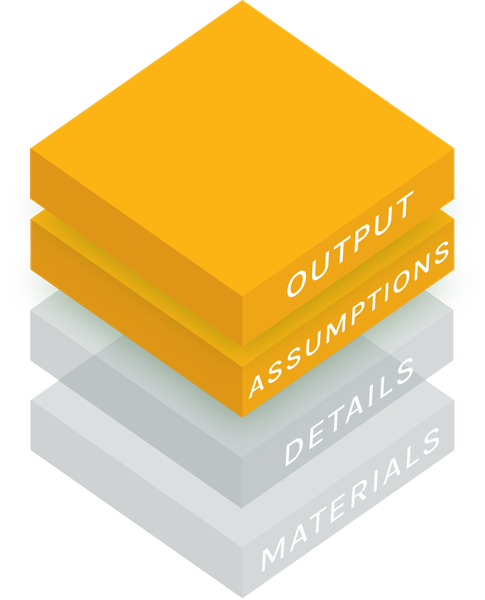

**Open Output**: one main estimate, with each assumption as a dial a reader can move.

Here it is the BSZ analysis explorer. Its dials are the inputs of BSZ’s Table 5, such as the avoidance share and the share of it that is leaving. Each dial is tagged with the kind of claim it is, such as data or guesswork.

[Open the explorer](../../bsz-analysis/site/explorer/) &middot; [Back to the BSZ analysis OPA](#opa-bsz)
]

.pull-right.layer-shot[
[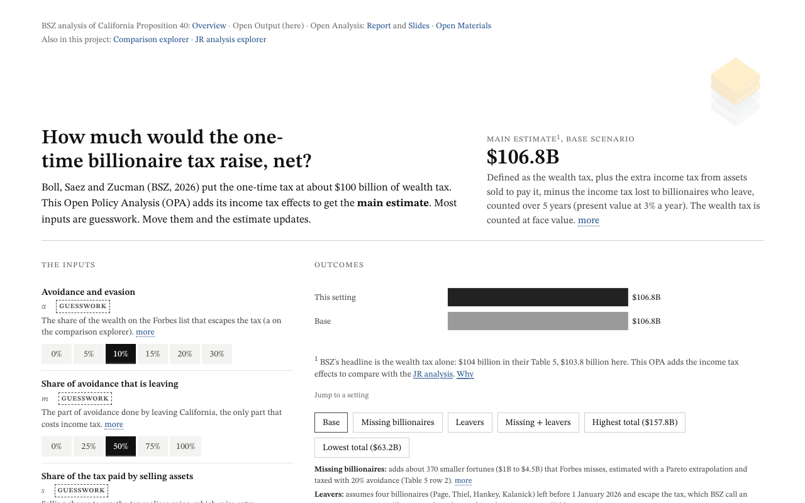](../../bsz-analysis/site/explorer/)
]

---
name: layer-bsz-analysis
class: layer-slide

# The BSZ analysis OPA: Open Analysis

.pull-left[


**Open Analysis**: every step from the inputs to the main estimate, written out, with the guesswork marked.

Here it is the report. It rebuilds BSZ’s tables step by step from the authors’ public workbook, with the R and Python code for each step beside it. The BSZ analysis deck is part of this layer too.

[Open the report](../../bsz-analysis/site/repro.html) &middot; [Back to the BSZ analysis OPA](#opa-bsz)
]

.pull-right.layer-shot[
[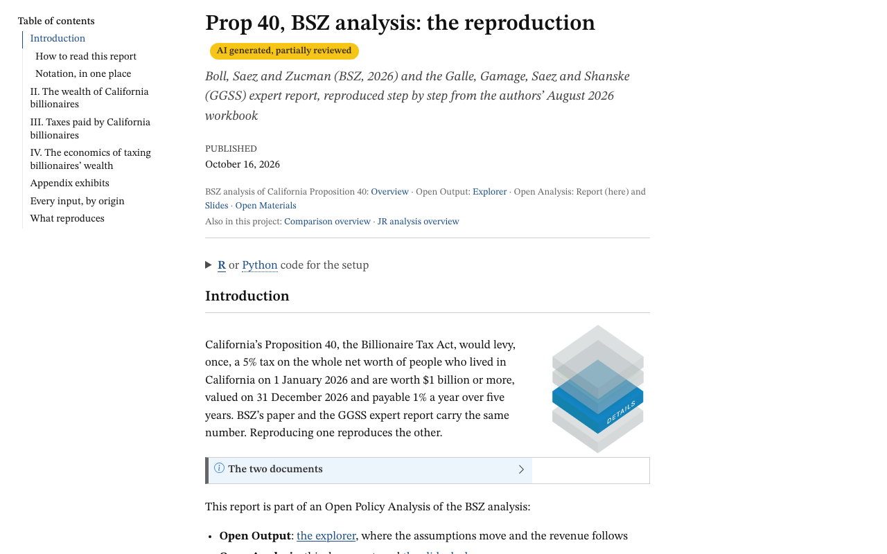](../../bsz-analysis/site/repro.html)
]

---
name: layer-bsz-materials
class: layer-slide

# The BSZ analysis OPA: its README

.pull-left[


**Open Materials**: the data, code and tests that rerun it.

Here it is the bsz-analysis folder of the public repository. Its README says what the folder holds and how to rerun it, and its first link is the code review on the next slide.

[Open the README](https://github.com/fhoces/opa-prop40/blob/main/bsz-analysis/README.md) &middot; [Back to the BSZ analysis OPA](#opa-bsz)
]

.pull-right.layer-shot[
[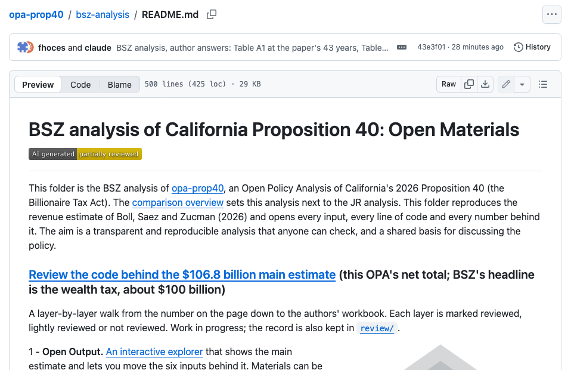](https://github.com/fhoces/opa-prop40/blob/main/bsz-analysis/README.md)
]

---
name: layer-bsz-review
class: layer-slide

# The BSZ analysis OPA: its code review

.pull-left[


**Open Materials**: a code review page to appraise the code. It walks the code behind the main estimate one layer at a time, from the number on the page down to the raw data.

Each layer shows its R or Python code, what goes in and out, whether the method matches the source, and how far it has been reviewed. Work in progress.

[Open the code review](https://claude.ai/artifact/6VZEezoAsCNACjmgPLEvah) &middot; [Back to the BSZ analysis OPA](#opa-bsz)
]

.pull-right.layer-shot[
[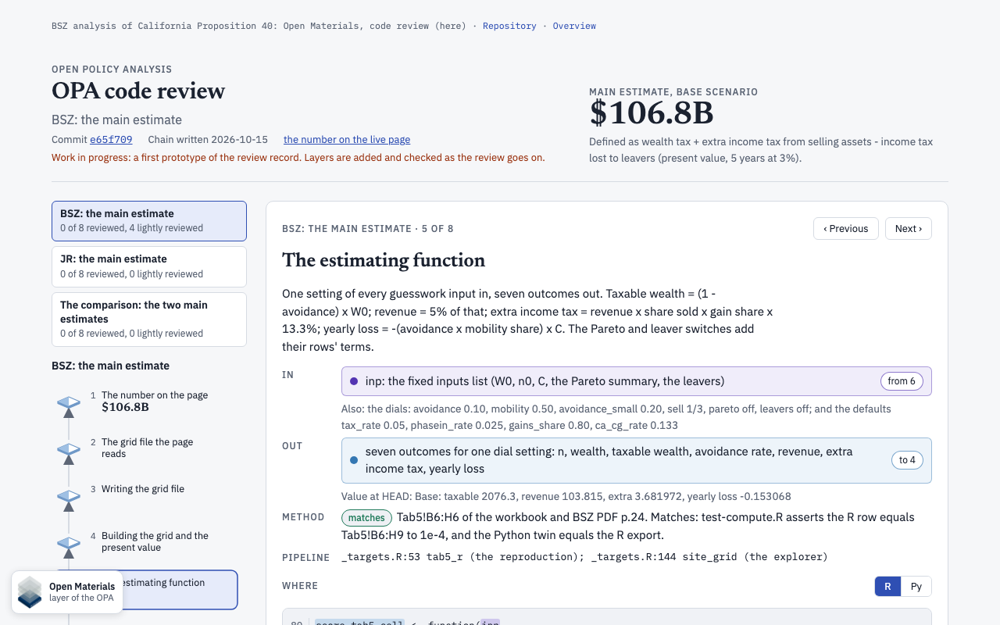](https://claude.ai/artifact/6VZEezoAsCNACjmgPLEvah)
]

---
name: layer-jr-output
class: layer-slide

# The JR analysis OPA: Open Output

.pull-left[


**Open Output**: one main estimate, with each assumption as a dial a reader can move.

Here it is the JR analysis explorer. Its dials are the inputs of the authors’ Monte Carlo, such as the range the wealth tax draw can pick, plus two dials of this OPA. Each dial is tagged with the kind of claim it is.

[Open the explorer](../../rjkdc-analysis/site/explorer/) &middot; [Back to the JR analysis OPA](#opa-jr)
]

.pull-right.layer-shot[
[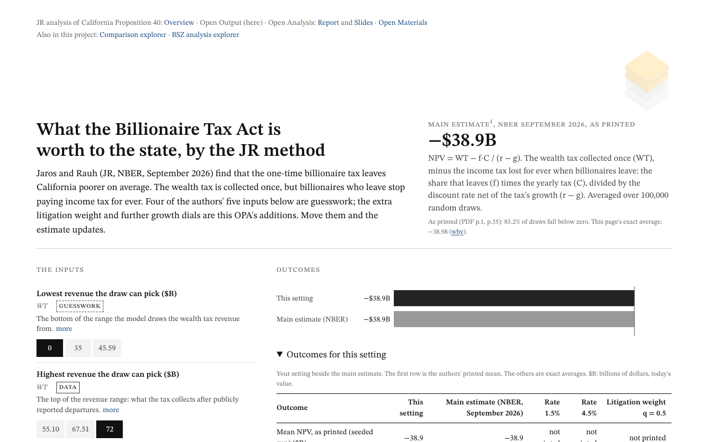](../../rjkdc-analysis/site/explorer/)
]

---
name: layer-jr-analysis
class: layer-slide

# The JR analysis OPA: Open Analysis

.pull-left[


**Open Analysis**: every step from the inputs to the main estimate, written out, with the guesswork marked.

Here it is the report. It reruns the authors’ code as shipped, section by section of the chapter, with the R and Python code beside each step. It records where the text, the READMEs and the code disagree.

[Open the report](../../rjkdc-analysis/site/repro.html) &middot; [Back to the JR analysis OPA](#opa-jr)
]

.pull-right.layer-shot[
[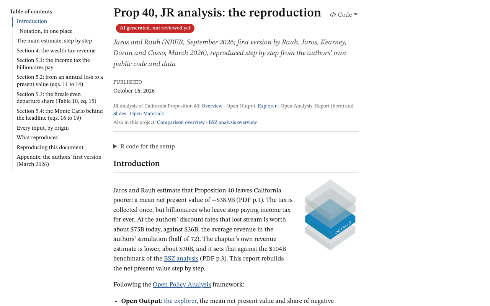](../../rjkdc-analysis/site/repro.html)
]

---
name: layer-jr-materials
class: layer-slide

# The JR analysis OPA: its README

.pull-left[


**Open Materials**: the data, code and tests that rerun it.

Here it is the rjkdc-analysis folder of the public repository. Its README says what the folder holds and how to rerun it, and its first link is the code review on the next slide.

[Open the README](https://github.com/fhoces/opa-prop40/blob/main/rjkdc-analysis/README.md) &middot; [Back to the JR analysis OPA](#opa-jr)
]

.pull-right.layer-shot[
[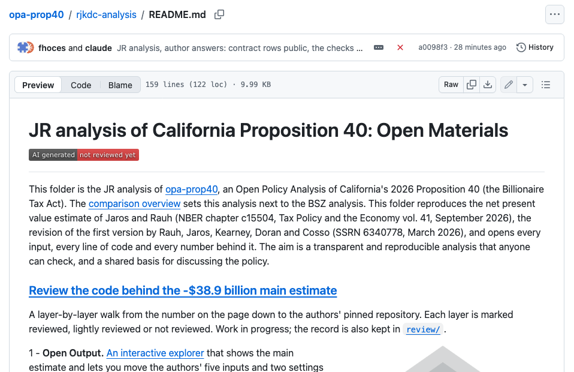](https://github.com/fhoces/opa-prop40/blob/main/rjkdc-analysis/README.md)
]

---
name: layer-jr-review
class: layer-slide

# The JR analysis OPA: its code review

.pull-left[


**Open Materials**: a code review page to appraise the code. It walks the code behind the main estimate one layer at a time, from the number on the page down to the raw data.

Each layer shows its R or Python code, what goes in and out, whether the method matches the source, and how far it has been reviewed. Work in progress.

[Open the code review](https://claude.ai/artifact/MykX5F4qRYF9gzCAbxBQUL) &middot; [Back to the JR analysis OPA](#opa-jr)
]

.pull-right.layer-shot[
[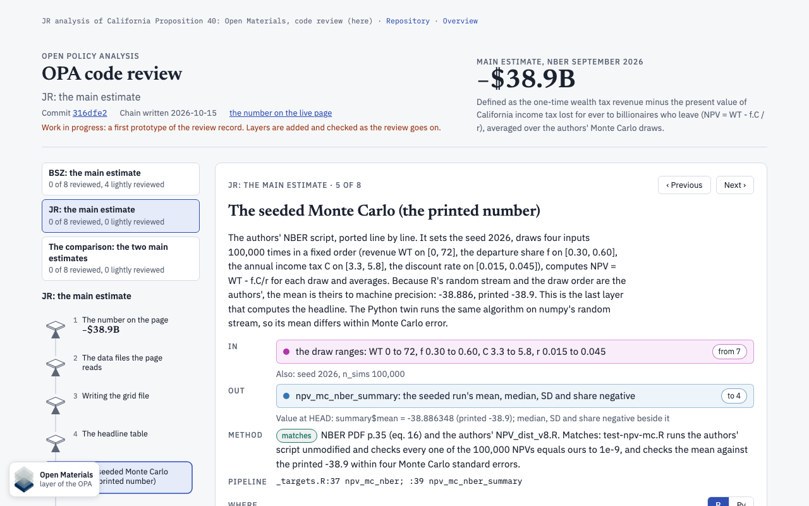](https://claude.ai/artifact/MykX5F4qRYF9gzCAbxBQUL)
]

---
name: layer-cmp-output
class: layer-slide

# The comparison OPA: Open Output

.pull-left[


**Open Output**: one main estimate, with each assumption as a dial a reader can move.

Here it is the comparison explorer. Each disputed input is a dial that can take either analysis’s value, and the equation shows how the dials take one estimate to the other.

[Open the explorer](../../comparison/site/explorer/) &middot; [Back to the comparison OPA](#opa-comparison)
]

.pull-right.layer-shot[
[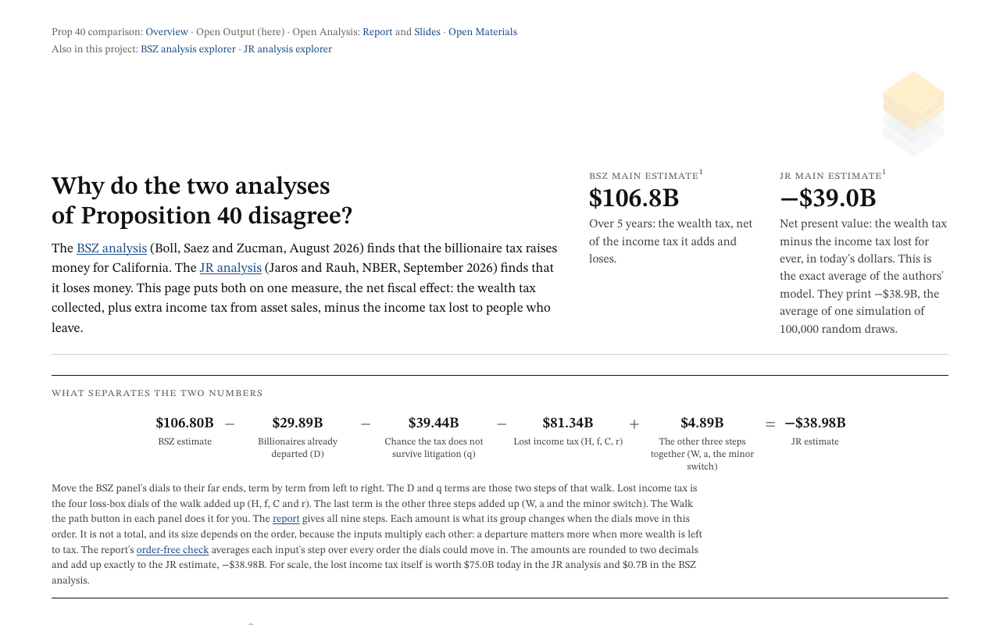](../../comparison/site/explorer/)
]

---
name: layer-cmp-analysis
class: layer-slide

# The comparison OPA: Open Analysis

.pull-left[


**Open Analysis**: every step from the inputs to the main estimate, written out, with the guesswork marked.

Here it is the report, and this deck. The report puts both analyses on one common output and walks from one main estimate to the other, one disputed input at a time.

[Open the report](../../comparison/site/repro.html) &middot; [Back to the comparison OPA](#opa-comparison)
]

.pull-right.layer-shot[
[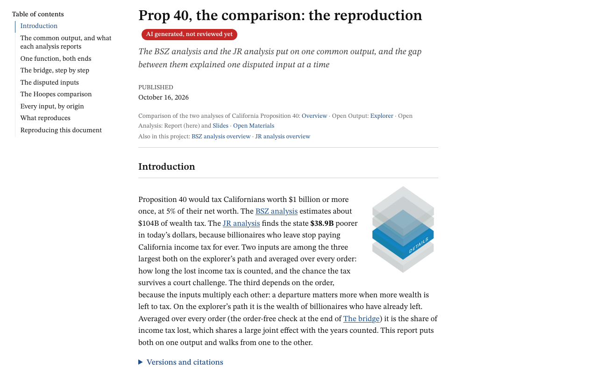](../../comparison/site/repro.html)
]

---
name: layer-cmp-materials
class: layer-slide

# The comparison OPA: its README

.pull-left[


**Open Materials**: the data, code and tests that rerun it.

Here it is the comparison folder of the public repository. Its README says what the folder holds and how to rerun it, and its first link is the code review on the next slide.

[Open the README](https://github.com/fhoces/opa-prop40/blob/main/comparison/README.md) &middot; [Back to the comparison OPA](#opa-comparison)
]

.pull-right.layer-shot[
[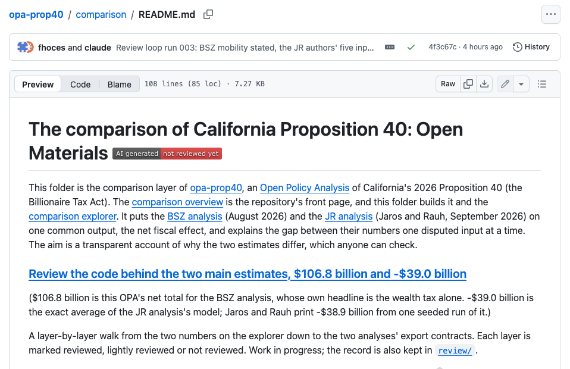](https://github.com/fhoces/opa-prop40/blob/main/comparison/README.md)
]

---
name: layer-cmp-review
class: layer-slide

# The comparison OPA: its code review

.pull-left[


**Open Materials**: a code review page to appraise the code. It walks the code behind the main estimate one layer at a time, from the number on the page down to the raw data.

Each layer shows its R or Python code, what goes in and out, whether the method matches the source, and how far it has been reviewed. Work in progress.

[Open the code review](https://claude.ai/artifact/RyHG9pVfrp3ZTxq2KJic4C) &middot; [Back to the comparison OPA](#opa-comparison)
]

.pull-right.layer-shot[
[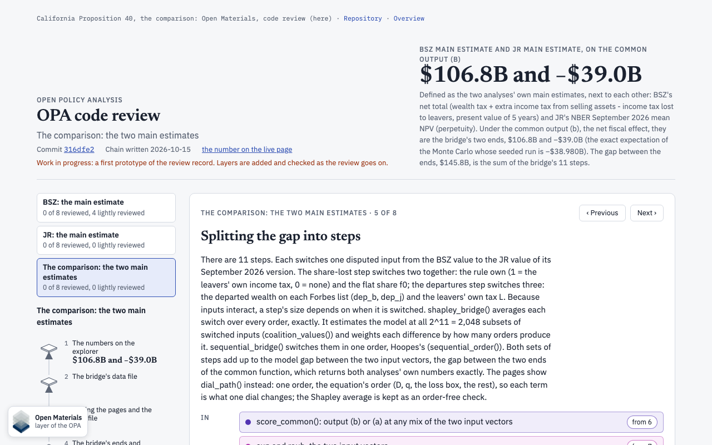](https://claude.ai/artifact/RyHG9pVfrp3ZTxq2KJic4C)
]

